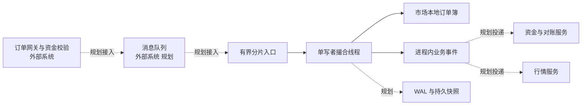

# tide-matching-engine

使用 Rust 实现的中心化交易所现货撮合内核，提供价格时间优先的订单簿、撮合规则和进程内单写者运行时。

> 当前为技术演示和持续开发项目：订单簿与进程内运行时已实现；WAL、持久快照、崩溃回放、命令去重和行情发布尚未实现，不能据此部署为生产交易所。

## 核心特性

**已实现的内核能力**

- 独立的生产订单簿和参考订单簿；生产簿使用价格索引、订单索引与价档 FIFO，参考簿使用独立的 `Vec + sort` 模型。
- 限价单、市价单、GTC、IOC、FOK、PostOnly、冰山订单、止损触发、改单、撤单替换和批量撤单；具体支持组合见 [订单簿模块说明](docs/orderbook_modules.md) 和 [撤单替换支持矩阵](docs/cancel_replace.md)。
- 价格优先、同价 FIFO、maker 价格成交；整数价格与数量、checked 算术及独立的市场数值规则。
- 用户市价保护、市场价格带及自成交防护（STP）；逻辑时间驱动 DAY/GTD 和会话到期。
- 进程内单写者分片、有界队列、显式市场路由、分片内序号、线性化查询和排空关闭。runtime 当前仅暴露 GTC Place、低层 Cancel、基础数量市价、单订单查询和屏障；Place 支持已实现的 STP。
- 独立 Reference/Production 差分、固定种子命令磁带、性质和并发测试。

**边界与规划**

撮合内核负责订单匹配、订单簿状态和业务事件。账户与余额校验、资金冻结及释放、费率决策、完整风控、清结算、前端和网关服务属于外围系统。仓库的 `matching-risk` 包含本地预留令牌验证与登记表计划，用于验证接口和归属；它不是完整账户、风控或结算系统。当前订单终结后的 `PendingR2` 只表示归属迁移，不表示资金已释放。

WAL、快照持久化、崩溃恢复、命令幂等去重、稳定事件编解码、行情快照及增量发布均为后续规划，不是现有运行时能力。

## 架构总览



实线表示当前代码中可用的进程内关系；虚线表示规划中的外围接入或持久化，并非已实现的 MQ、WAL 或事件发布。余额校验、预留授权和费用决策由调用方或外围系统负责。

workspace 包含 `matching-domain`、`matching-orderbook`、`matching-runtime`、`matching-risk`、`matching-persistence` 和 `matching-protocol`；后两者目前是骨架。每个生产订单簿是市场本地状态，runtime 使用显式路由将市场交给唯一分片线程；跨进程所有权、迁移和高可用尚未实现。

## 订单状态

领域层提供 `Accepted`、`PartiallyFilled`、`Filled`、`Canceled`、`Expired` 和 `Rejected` 状态标签；该枚举本身不校验状态迁移。典型业务关系如下，具体入口以实际返回的结果和 `EngineEvent` 为准：

- 通过接收检查后进入 `Accepted`；接收前校验失败可表现为 `Rejected`。
- 已接收订单部分成交进入 `PartiallyFilled`，之后可以继续部分成交、全部成交、撤销或到期。
- 全部成交进入 `Filled`；撤销或剩余量按规则终结进入 `Canceled`；有效期到达进入 `Expired`。
- `Filled`、`Canceled`、`Expired` 和 `Rejected` 是上述模型的终结状态。当前尚无覆盖所有入口的统一持久化订单状态机。

## 撮合规则

- **价格优先、时间优先**：买方更高价、卖方更低价优先；同价按真实挂单队列 FIFO。成交价格取 maker 价格。
- **数值校验**：`Price`、`Qty` 使用整数；完整市场规则通过 `MarketMath` 校验 tick、lot、精确本金和溢出。低层入口可能要求调用方先完成市场规则校验，不能假定每个入口都自动执行相同的 R1 校验。
- **STP**：支持已实现的 CancelMaker、CancelTaker、CancelBoth 等策略；不把自成交拦截构造成真实 Trade。各订单入口的支持范围以代码和测试为准。
- **IOC**：尽可能立即成交，未成交余量终结，不入簿。
- **FOK**：先在候选计划中检查完整可执行量与约束；不足时不提交成交或订单簿变更。
- **市价保护**：在命令开始固定参考价，合并用户保护和市场价格带；首个越界 maker 不成交。配置与舍入规则见 [数值公式](docs/numerical_formulas.md)。

余额、费率及完整风控由调用方或外围资金系统提供；撮合不能将业务余量当作资金释放。

## 快速开始

项目通过 [`rust-toolchain.toml`](rust-toolchain.toml) 固定 Rust **1.98.0**，使用 Rust 2024 edition、`rustfmt` 和 `clippy`。在仓库根目录执行：

```bash
rustup show active-toolchain
cargo build --workspace
cargo fmt --check
cargo clippy --workspace --all-targets -- -D warnings
cargo test --workspace
```

当前仓库没有网络服务或可独立启动的撮合进程，因此没有 `cargo run` 服务启动命令。可在另一个 Rust 程序中以库方式依赖 `matching-domain` 和 `matching-orderbook`。例如在该程序的 `Cargo.toml` 中填写实际路径：

```toml
[dependencies]
matching-domain = { path = "../tide-matching-engine/crates/matching-domain" }
matching-orderbook = { path = "../tide-matching-engine/crates/matching-orderbook" }
```

```rust
use matching_domain::{
    ClusterId, LimitOrder, OrderId, Price, Qty, ShardId, Side, StpKey, StpMode,
    TradeIdCursor, UserId,
};
use matching_orderbook::{ProductionOrderBook, QueuePriorityPolicy};

fn order(id: u128, user: u64, side: Side, price: i64, qty: u64) -> LimitOrder {
    LimitOrder {
        order_id: OrderId(id),
        user_id: UserId(user),
        stp_key: StpKey::new(0),
        stp_mode: StpMode::None,
        side,
        price: Price::try_new(price).unwrap(),
        qty: Qty::try_new(qty).unwrap(),
    }
}

fn main() {
    let policy = QueuePriorityPolicy::try_new(1024).expect("有效的优先级策略");
    let mut book = ProductionOrderBook::new(policy);
    book.rest(order(1, 10, Side::Sell, 100, 2))
        .expect("挂入卖单");

    let mut cursor = TradeIdCursor::new(ClusterId(1), ShardId(1), 1);
    let events = book
        .place_limit_gtc_with_cursor(order(2, 20, Side::Buy, 101, 1), &mut cursor)
        .expect("执行买单");
    for event in events {
        println!("{event:?}");
    }
}
```

示例展示直接调用订单簿：卖单为 maker，买单为 taker，成交价为 `100`。示例未接入账户、资金或生产订单入口，调用方须自行提供有效身份并执行适用的市场和资金校验。使用单写者线程和显式路由的接口见 [runtime 说明](docs/runtime.md)。

## 配置说明

当前没有 TOML 配置文件解析器；市场数值规则、队列容量、等待策略和路由通过 Rust 类型显式构造。下面仅示意外围应用可以提供的配置结构，**不能直接作为本项目配置文件加载**：

```toml
[market]
market_id = 1
price_scale = 0
qty_scale = 0
quote_scale = 0
tick_size = 1
lot_size = 1

[shard]
shard_id = 1
route_epoch = 1
capacity = 1024
mutation_reserved_slots = 1
max_query_inflight = 512
max_control_inflight = 128
wait_strategy = "Hybrid"
```

应用须自行解析和验证配置，再构造 `MarketMath`、`MarketRoute` 和 `ShardConfig`；不同数值 scale 与最小 tick × lot 的精确本金约束见 [数值公式](docs/numerical_formulas.md)。

## 持久化与崩溃恢复

**当前未实现 WAL、持久快照、崩溃回放或命令去重。** 现有 `shard_seq` 和路由快照只在进程内生效；进程重启后从头分配，不能保证跨重启序号或 TradeId 唯一性。`CommandId` 当前只用于关联结果，不提供幂等保证。

规划中的恢复链路为：先持久化已接收变更及其顺序，再定期保存一致性快照；恢复时加载已验证快照，按持久日志顺序重放后续变更，并通过持久去重状态防止重复应用。写入顺序、截断与损坏处理、事件发布和恢复一致性都需要在持久化实现阶段单独设计与验证。

## Benchmark

当前没有可引用的性能基准结果或吞吐承诺。未来基准应分别记录硬件、构建参数、订单分布、簿深、线程配置和样本量：

| 指标 | 含义 | 结果 |
|---|---|---|
| 撮合延迟 p50 / p99 | 内核接收已准备命令到完成撮合的延迟分位数，不含网络和 MQ | 待测 |
| 撮合吞吐量 | 指定负载下每秒完成的订单或命令数量 | 待测 |
| 入口繁忙率 | 有界入口因容量、配额或准入竞争返回 Busy 的比例 | 待测 |

端到端延迟应单独统计，不能把网络、消息队列或持久化时间混入纯撮合内核指标。

## 测试体系

- **单元与边界测试**：数值校验、订单簿结构、FIFO、订单规则、STP、价格保护和失败原子性。
- **差分与性质测试**：独立 Reference/Production 逐命令比较原序事件和状态；包含固定种子 100k 混合命令磁带及重复运行场景。这是进程内确定性验证，不是 WAL 崩溃回放。
- **runtime 测试**：有界入口、路由、序号、查询与屏障顺序、关闭、故障传播和 100 个并发生产者。
- **持久化回放、故障注入与混沌测试**：WAL 和恢复尚未实现，相应测试属于后续工作。
- **fuzz**：可作为后续补充；不以未执行的 fuzz 测试宣称覆盖。

完整检查命令及近期本地验证证据见 [工程规则](AGENTS.md)；测试结果不等于生产安全性。

## 事件协议

当前事件为 Rust 进程内类型，尚无稳定 EventEnvelope、网络协议或事件日志格式。

| 类型 | 关键内容 | 当前状态 |
|---|---|---|
| `TradeEvent` | `trade_id`、`maker_order_id`、`taker_order_id`、maker 价格 `price`、成交数量 `qty`、`maker_side` | 已实现；不含费用、结算或持久化元数据 |
| 订单生命周期事件 | `EngineEvent` 包含接收、挂单、部分成交、完成、取消、改单等变体；取消余量区分 Base / Quote | 已实现部分事件载荷；并非所有低层入口都生成完整生命周期事件 |
| `BookSnapshotEvent` | 市场、价格档位、聚合数量和快照序列等 | 规划中，尚无稳定类型或发布 |
| `BookDiffEvent` | 价格档位增量及行情序列等 | 规划中，尚无稳定类型或发布 |

maker 是提供挂单流动性的一方，taker 是主动与其成交的一方。对外可靠投递、行情序列、资金对账和去重应由后续协议与外围系统实现，不能假定当前事件已持久化。

## 设计取舍与已知限制

- 生产簿与参考簿独立实现，以差分测试换取可审查性；不能把测试通过等同于形式化证明。
- 工作线程独占订单簿，入口有界并可能返回 Busy；调用方负责超时、重试和背压策略。`ArrayQueue` 本身是 MPMC，本项目通过唯一消费者约束按 MPSC 使用。
- 当前 runtime 不暴露带真实预留登记表的下单、改单、止损和批量撤单，也不提供完整深度或订单列表查询；低层 Cancel 返回移除节点，不伪造资金释放。
- `TradeIdCursor` 按集群、分片、分片序号和命令内成交索引编码；只有实际 Trade 消耗索引。缺少持久化序列和 fencing 时，不能保证跨重启或跨进程唯一。
- 完整 MarketState/PreOpen、账户资金、手续费核算、Settlement、WAL、快照恢复、去重、HA、市场迁移和对外行情发布尚未完成。

## 生产部署建议与监控

当前版本不具备生产部署条件。上线前应完成账户与资金对接、持久化及恢复、幂等、权限与隔离、主节点 fencing、行情和事件可靠投递，并经过独立代码审计、故障演练、性能压测与资金对账。

未来部署可监控队列占用与 Busy 比例、命令处理延迟、分片线程存活和失败、路由版本拒绝、业务拒绝率、序号水位，以及 WAL 持久化延迟、回放状态、事件积压和对账差异。队列持续饱和、线程异常退出、持久化失败、序号异常或对账不一致应触发告警；这些是建议指标，不代表当前已接入监控系统。

## CHANGELOG

- **当前工作区**：本地实现并验收进程内单写者分片 runtime、显式路由和命令级 TradeId 游标；交付状态以 Git 记录为准。
- **T16**：本地提交市场价格带及用户保护集成，提交 `625bdd2`。
- **T15 / T14**：分别完成自成交防护、批量撤单的本地交付。
- **此前阶段**：完成订单簿、限价和市价、冰山、止损、逻辑时间和改单等基础能力。

## 免责声明

本项目仅用于技术演示和工程研究，不构成可直接上线的交易所或投资建议。任何实际部署前都必须完成独立安全审计、压力测试、故障恢复演练和资金对账验证。

## 术语

- **tick_size / lot_size**：价格最小步长 / 基础数量最小步长。
- **WAL**：预写日志，用于记录状态变更；本项目尚未实现。
- **IOC / FOK**：立即成交剩余取消 / 仅在可全部立即成交时执行。
- **maker / taker**：提供挂单流动性的一方 / 主动消耗流动性的一方。
