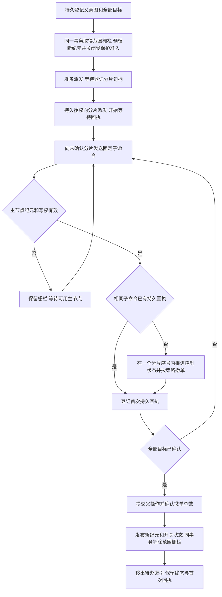

# 跨分片撤单与开关

要撤销某个用户在所有市场的订单，管理端以唯一父命令向 `CrossShardCoordinator` 登记 `UserMassCancel`。目标集合来自集群的完整部署配置，包括临时离线以及尚未持有市场的分片。每个目标收到独立的子命令。管理端取得 `Done` 后，可从同一父记录读取每个分片的首次提交序号和实际撤单总数。用户开关、全局开关、全局撤单使用同一协议。

## 启动、派发与恢复

在外围控制线程取得 `EtcdControlStore` 协调者租约。网关和持久分片使用同一业务集群的准入权威。部署方须在服务期间续租，接任时用相同命名空间重新取得写权。将分片的持久句柄通过 `attach` 绑定到协调器；换主后绑定新的句柄。首次登记使用完整可信的分片成员表。已有旧版用户控制下限的部署应在停写切面核对各分片的实际下限，由当前所有者使用 `import_user_epoch` 导入每个用户的最大值，再开放新协调者。工作线程每次启动或恢复时均须重新绑定原控制命名空间。

`prepare` 保存父命令、策略和固定目标，`step` 最多推进一个持久阶段或登记一条分片回执。一次尝试中，早序分片未回复时仍可联系后续分片。`resume` 对暂时不可用的分片实施有界退避，超时后可用原父命令续办。重启时，`recover_pending` 读取一次持久索引，轮流推进此次读到的操作，逐项返回终态、超时或其他错误。扫描后才登记的操作由后续调用处理。失权后由新的租约持有者接手。读写失败、CAS 冲突或回复超时均保留已提交进度。同一父命令再次登记时，范围、策略和目标须一致。

只有尚未授权任何外部派发时才能安全中止。一旦进入 `AwaitingAcks`，即使确认集合为空，也可能已有分片持久提交但尚未送达回执。此时保留栅栏，按原身份重新投递分片子命令；分片使用首次回执避免重复撤单。各分片在各自的 WAL 顺序点提交，全部回执齐全后协调者才发布范围的新状态。在已确认一个目标、其他目标离线时，同一用户仍受栅栏保护。

## 命令身份与顺序

派生输入按顺序拼接 ASCII 字节串 `tide/cross-control/v1`、16 字节父命令、2 字节目标分片和意图。多字节整数采用大端。用户撤单的意图为标签 1 和 8 字节用户，全局撤单为标签 2。用户开关使用标签 3、8 字节用户及两个单字节布尔值，全局开关使用标签 4 和相同的布尔值。布尔值依次表示启用和同时撤单。对上述字节计算 SHA-256，取前 16 字节作为大端子命令身份。投递时另带当前主节点纪元。

范围栅栏与 Kill 生效状态分别记录。等待全体确认期间，受保护请求返回 `ControlFenceActive`（4006）。启用的 Kill 在栅栏释放后继续拒绝新委托。市场和来源会话批量撤单、订单查询继续走已有入口。单笔 Cancel 使用正式分片入口 `ShardHandle::submit_command`，按市场、用户、订单 ID 精确撤单并释放剩余预留；不占用协调者的控制纪元。启用协调权威时，受保护的下单须携带已发布的用户纪元。进入分片后，单写者按本地已应用的控制下限再次检查。历史 Session 断连撤单按来源会话和持久目标执行，详见[断连恢复](gateway.md)。纪元与撤单计数的边界见[数值计算公式](numerical_formulas.md)。
