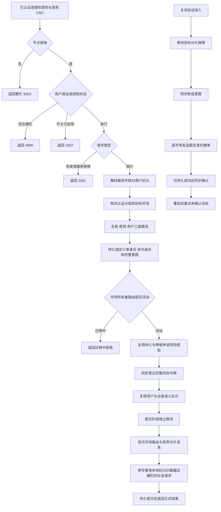

# 网关接入与断连撤单

网关会话将已认证用户的限价意图转换为分片正式消息；订单簿只由分片线程访问。认证通过 `GatewayAuthenticator` 接口注入，返回用户和可信账户的自成交分组；仓库没有生产认证服务。生产调用方负责保护凭据、校验重放、提供不复用的会话身份、控制会话身份和全局命令身份，并确保每个来源会话的可交易市场已完整登记。

限价会话只支持正式分片现已开放的 GTC / PostOnly；价格与数量是各市场的整数原子值，核心仍按市场配置验证 tick、lot、资金令牌及适用规则。外部请求不能指定用户或命令身份；网关在风险授权之前绑定身份，重试同一幂等键和意图返回原订单与命令身份，冲突拒绝。`GatewayIntentStore` 在风险授权前同步保存规范意图、命令和订单身份，并在分片提交前同步保存完整风险令牌；重启及新会话重试时复用相同身份与令牌，同键不同意图拒绝。风险服务必须按 CommandId 持久幂等，以覆盖风险授权成功但本地记录尚未确认的崩溃窗口；入队前失败或结果未知的资金预留由风险服务协调，不由网关伪造释放。进程内表和持久表均有容量上限且不自动淘汰；提交前必须持有持久登记凭据。持久表使用旁路双槽 manifest 登记已确认前缀，完整已确认记录缺失或损坏时失败关闭；未确认尾部在恢复时截断。该表仅保证受保护目录中的单机独占写入，跨主机部署须使用线性一致权威服务。订单号接口要求可信权威跨所有实例原子保留不重复计数器，并在返回前持久保留或重启时使用新纪元；当前仓库没有跨主机租约实现。`LeaseAuthority` 的真实性由部署方保证。

`GatewayShared` 持有所有连接共用的本地非阻塞单调时钟，其单位与令牌桶补充间隔一致，不推进业务逻辑时钟。部署方必须为所有会话共享同一 `GatewayRateLimiters`，它以两组独立令牌桶分别限制持久准备和每次分片入队尝试，且每组均约束全局、API key 和用户。准备阶段先限流再分配身份或写入持久意图；入队尝试即使遇到入口繁忙也计入提交限额，重试仍受限。身份表满及令牌不足与有界分片队列繁忙均可映射为 `EngineBusy = 5002`；时钟倒退和存储故障不伪装为繁忙。成功入队不等于完成；等待超时后须复用原命令身份，分片去重窗口淘汰后的重试不保证去重。

`GatewayTransport::serve_with` 在分片持久回复后、客户端回复前向外围交接结果。回调不持网关共享锁，也不在分片线程运行；返回错误或发生 panic 时节点不再就绪、客户端结果未知，连接仍执行断连清理，调用方应从已提交 WAL 恢复并按原命令身份核对。回调不得在 panic 信息中包含凭据或敏感载荷；运行时的 panic hook 可能输出该信息。并发连接的回调不保证分片序号顺序，调用方必须有界排序或检测缺口；该接口不提供持久事件日志。`serve` 仅处理接入回复，不向外围交接事件。

## 帧和载荷

整数均为大端。帧头为 `TIDE` 四字节魔数、`u16` 版本（当前 1）、`u16` 类型、`u16` 标志、`u64` 请求身份和 `u32` 载荷长度；其后是载荷和 `u32` CRC32C，CRC 覆盖帧头及载荷。最大帧长度包含头、载荷和 CRC。流式接收方必须在读取或分配载荷之前先调用 `frame_length` 检查声明长度。只接受完整单帧，不接受尾随数据。

类型 1 是限价请求：依次为 `u128` 幂等键、`u32` 市场、`i64` 价格、`u64` 数量、`u64` 自成交分组、`u64` 用户控制纪元、`u8` 方向（0 买、1 卖）、`u8` STP（0 无、1 撤吃单、2 撤挂单、3 撤双方）、`u8` PostOnly、`u8` 客户端身份存在标志、`u16` UTF-8 字节长度及字符串。价格和数量严格正；未知枚举、无效 UTF-8 和超限均拒绝。用户和自成交分组必须与认证服务授权一致。类型 2 是拒绝回复，载荷为大端 `u16` 稳定原因编号，未知编号原样保留。类型 3 是成功回复，载荷依次为 `u128` 命令身份、`u128` 订单身份和 `u64` 分片序号。请求身份只关联回复；分片会话别名序号独立由持久意图日志的位置派生。

## 跨分片控制准入

直接使用已认证 `GatewaySession` 的调用方通过 `prepare_wire_for_shard` 提供分片句柄，在风险授权前核对控制权威并持久登记意图。独立部署的 `prepare_wire_durable` 将新意图绑定到初始全局纪元零。TCP 传输使用与直接会话相同的准入及意图登记规则。

类型 4 表示 Amend，类型 5 表示 CancelReplace。已认证连接在完整帧通过长度、CRC 和节点就绪检查后，对类型 1、4、5 以一次权威读取得到用户及全局状态。任何一个范围处于 FENCING 都返回 `ControlFenceActive`（4006）。各范围均无栅栏时，已启用的 Kill 返回 `KillSwitchActive`（1007）。控制放行后，类型 4、5 直接返回 `InvalidOrderCombination`（2001），目前没有可执行的网关改单或撤单替换载荷。类型 1 继续解码和校验。这些前置拒绝发生在风险授权、身份分配和分片入队之前。

启用跨分片控制时，网关要求客户端的用户控制纪元与权威当前发布值相等。未来纪元和过期纪元都返回 4005。网关首次准备意图时，将规范请求内的用户纪元及权威全局纪元与命令、订单身份同步保存。非零全局纪元使用 GIN1 身份记录长度字段的掩码 `0x4000_0000` 标记，在规范请求长度后、请求字节前追加大端 `u64` 纪元，CRC 覆盖该字段。旧记录的全局纪元为零。用相同幂等键和规范意图重试时，若用户校验通过但持久记录中的全局纪元已过期，网关返回 4006。

风险授权后，每次入队尝试都在网关连接线程再次读取权威。直接使用正式分片句柄提交的下单也在生产者线程读取权威。读取失败时，本次投递终止。若请求在栅栏建立前已通过最后一次权威读取，分片按实际队列顺序处理。先执行的挂单由后续控制命令按策略撤销；排在控制命令之后的旧下单由单写者比较本地用户和全局纪元，在去重和编号前拒绝。等待权威响应的生产者不会占用撮合线程。

FENCING 期间，正式分片句柄仍接受按用户、市场和订单身份提交的单笔 Cancel。市场或来源会话的批量撤单、订单查询和排空屏障也继续沿各自入口处理。当前网关 TCP 协议未定义单笔 Cancel 或 Query 帧。

## 断连恢复边界

`SessionControlJournal` 在启用会话前同步来源用户、会话、独立控制会话、断连撤单开关及有界市场目标和固定命令身份；禁用断连撤单时关闭会话不生成撤单目标。调用方确保所有来源会话命令只经单个 `GatewaySession` 准入；关闭时先拒绝新请求，对全部目标分片等待屏障，再同步断连记录。系统重启后旧连接不能继续提交，重新打开日志会关闭仍开放的旧会话；每次派发前再次等待目标分片屏障，确保先前已准入消息先完成。每个目标均以持久命令身份、用户和来源会话过滤；只在收到持久正式分片的成功回复后记录确认。入队失败、业务拒绝或回复超时保留待执行目标；超时表示结果未知。日志使用独占文件锁、CRC 和长度检查，损坏或截断失败关闭，不自动跳过记录。

会话日志保存在调用方独占并保护的单机目录。会话持久固定市场和撤单命令身份。断连排空和撤单派发按当前公布的活动所有者定位分片，路由纪元至少须达到会话持久记录的下限。调用方须保证旧会话身份、控制会话身份及各命令身份不复用，收到持久成功后才能确认对应目标。

限价请求通过健康准入后，网关先持久登记身份，再选择当前市场所有者。选路时若已公布迁移中状态，网关在申请风险授权前返回 `MigrationInProgress`。若已取得令牌，随后在提交时发现所选分片不再符合路由要求，或分片在入队后返回 `StaleRouteEpoch`，网关重新选择所有者，沿用原命令、订单和令牌，最多再试两次。重新提交仍受限流约束。已入队的请求回复超时，网关报告结果未知。所有权切换与恢复步骤见[停市迁移](market_migration.md)。

`GatewayTransport` 可处理已认证会话的有界双向字节流，支持由调用方接受并配置超时的 TCP 连接。连接结束时排空并执行会话撤单。多个连接共享 `GatewayShared`，共享锁只覆盖有限身份登记、持久提交和有界入队。网络读写、风险授权和分片回复等待均在锁外执行。身份分配回调须使用预先取得的本地租约额度。调用方负责监听、会话认证、身份分配和具备命令幂等性的风险授权。

## 协议模糊测试

`crates/matching-protocol/fuzz` 是独立的 `cargo-fuzz` 测试工程，不进入运行时依赖。目标同时验证任意帧、带有效 CRC 的请求载荷与拒绝载荷，成功解码的结果必须能重新编码为原始字节。可从 `tests/golden/frame_v1.bin` 复制一个种子到独立临时 corpus，再使用固定 seed 和运行次数执行；Windows 的 AddressSanitizer 运行时目录须在进程 `PATH` 中。模糊测试及其依赖不替代实际网络、崩溃或生产权限验证。
