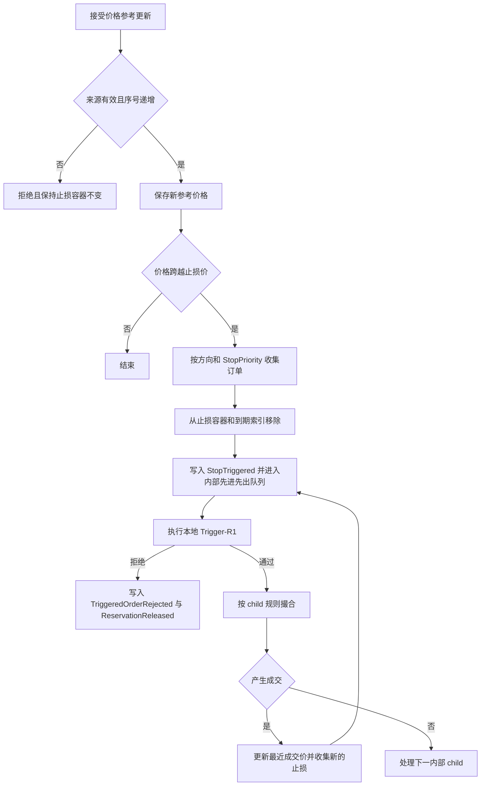
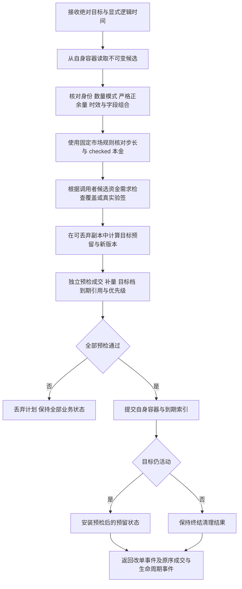
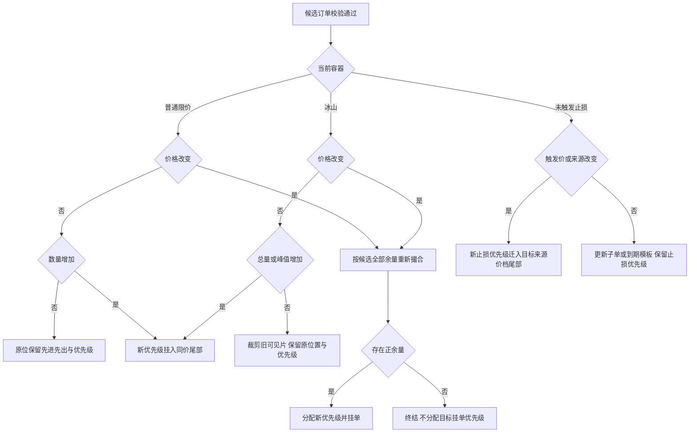
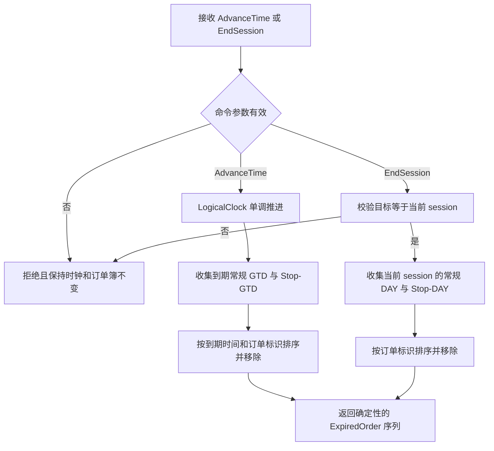

# 匹配引擎关键逻辑流程图

本文件是项目关键逻辑流程图的长期入口。当前收录已验收及已完成本地验证但尚未提交的工程基础、订单簿和行为差分验证流程；后续经过验收的重要流程也应补入此文件。现有图不表示尚未实现的扩展订单规则、持久化或运行时能力。

## 工程基础与本地质量门

```text
Cargo workspace members + fixed Rust toolchain
                    |
                    v
         cargo fmt --check
                    |
                    v
 cargo clippy --workspace --all-targets -- -D warnings
                    |
                    v
          cargo test --workspace
                    |
          +---------+---------+
          |                   |
          v                   v
       pass: evidence      fail: retain error,
       for review          do not claim acceptance
```

工程基础固定 workspace、工具链和 lint 继承；质量门只提供自动化证据，不能替代对确定性、checked arithmetic 和业务不变量的审查。

## 领域值构造与错误边界

```text
external integer input
        |
        v
positive constructor (Price / Qty / QuoteBudget)
        |
   +----+-----------------+
   |                      |
   v                      v
valid canonical value   RejectReason
private representation  (invalid canonical value)
        |
        v
typed order and trade payloads
```

领域模型使用整数原始值表示价格、数量和金额，原始值不是 tick/lot 个数。`Price`、`Qty`、`QuoteBudget` 构造时检查严格正值；`QuoteAmount` 允许零，`SignedAmount` 允许负数。市场 tick/lot 对齐与金额可表示性由数值校验层负责，不能由值对象构造成功推断。

## 数值配置与精确本金

```text
price / quantity / quote scales + tick + lot
  -> reject non-positive tick or lot
  -> signed scale difference; cancel common decimal powers
  -> checked reduced scale factor
  -> exact positive minimum tick-lot notional K
  -> publish immutable MarketMath only if all checks pass

trade_notional(price, qty)
  -> price tick alignment -> quantity lot alignment
  -> checked tick-count * lot-count * K
  -> exact quote amount, or explicit error; never round principal

max_qty_for_quote(remaining quote, price)
  -> price tick alignment
  -> affordable whole lots, capped by representable quantity
  -> zero lots: None; otherwise positive aligned Qty
```

具体换算、表示上限及取整关系见[数值计算公式](numerical_formulas.md)。配置失败不发布半初始化对象；撮合入口将可拒绝的数学错误映射为稳定原因，配置/状态不变量损坏按 fail-closed 处理。

## 参考订单簿的撮合基线

```text
incoming Limit GTC
        |
        v
choose opposite-side maker from Vec + stable sort
        |
        +-- no crossing or incoming exhausted --> stop; do not rest incoming
        |
        v
plan one fill (maker ID, maker price, min remaining qty)
        |
        v
checked deductions for maker and incoming
        |
        +-- maker exhausted --> remove from Vec
        |
        v
emit caller-supplied TradeId as TradeEvent
        |
        v
repeat until stop
```

参考簿保留 `Vec + sort`，提供独立行为基线。此处底层限价撮合不会将 incoming 余量自动挂单；差分测试的 Reference GTC 适配器补上剩余量 rest，再与生产完整 GTC 入口比较。市价与 IOC/FOK 使用各自独立的预检和提交入口。

## 订单簿存储、FIFO 与优先级

```text
owner read-only checks: identity / priority / level aggregate / Arena capacity
    |
    v
prevalidated resting node
    |
    v
OrderArena::insert
    |
    +-- free-list nonempty --> reuse its LIFO tail slot
    |
    +-- otherwise ----------> append a new stable slot
    |
    v
PriceLevel::push_back
    |
    +-- empty level --> head = tail = new slot
    |
    +-- nonempty ----> old tail.next <-> new.prev; tail = new slot
    |
    v
count / total_visible_qty updated with checked arithmetic
    |
    v
QueuePriority advances on successful rest or iceberg refresh
```

同价 FIFO 的权威顺序是 `PriceLevel` 从 head 到 tail 的 intrusive 链，不是 OrderId、Arena 槽位号或 HashMap 遍历顺序。图中 priority 推进属于生产簿 owner 的成功挂单或补量重新排队提交；Arena/PriceLevel 本身不分配 priority。删除时先解除链表引用，释放槽位并在同一独占 mutation 内清理 active ID 映射；映射清理完成前不能复用槽位或对外暴露中间状态。

## 按身份取消与槽位释放

```text
Cancel(OrderId)
  -> HashMap single-key lookup
       absent -> OrderNotFound; state unchanged
       present -> validate Arena identity and owning price level
  -> head: pop_front; middle / tail: unlink
       validate local links and aggregate before writes
       detach node, update level, release Arena slot
  -> remove empty price level if needed
  -> remove OrderId mapping before completing exclusive mutation
  -> return detached node; priority unchanged
```

ID 查找平均 O(1)，已知节点的局部链表删除为 O(1)；定位或删除 BTreeMap 价档仍有 O(log P) 成本，因此不能将整个 Cancel 描述为严格 O(1)。内部索引/链接损坏属于 fail-closed，不伪装成 `OrderNotFound`。

## 生产订单簿的完整 Limit GTC

```text
LimitGtcOrder + caller-supplied TradeIds
                 |
                 v
1. reject duplicate active OrderId
                 |
                 v
2. read-only FillPlan
   Buy: asks low -> high; Sell: bids high -> low; FIFO per level
                 |
                 v
3. assert enough TradeIds before the first mutation
                 |
       +---------+---------+
       |                   |
       v                   v
  exact fill          positive residual
       |                   |
       |           4. common rest preflight
       |              duplicate/priority/aggregate/Arena
       |                   |
       +---------+---------+
                 |
                 v
5. commit continuous maker fills in planned order
   partial maker: reduce node + level aggregate
   full maker: pop FIFO head, remove ID index, clear empty level
                 |
       +---------+---------+
       |                   |
       v                   v
  no residual       residual remains
       |                   |
       |           assert book is strictly uncrossed
       |           commit rest at own level tail
       |           write ID index, then advance priority
       +---------+---------+
                 |
                 v
return TradeEvents in actual matching order
```

生产订单簿使用 BTreeMap 决定双侧价格优先，使用 `PriceLevel` 决定同价 FIFO，HashMap 只做单个 OrderId 定位。此 GTC 入口和基础 rest 不接受 MarketMath，调用方须先完成市场数值校验。入口内所有可预期的 `RejectReason` 在第一笔成交前结束；预检与提交发生分歧属于内部不变量损坏，按 fail-closed 处理。

## 市价订单的预检、保护与提交

```text
MarketByBase / MarketByQuote + caller-supplied TradeIds
                         |
                         v
1. reject duplicate active OrderId before reading liquidity
                         |
                         v
2. protected entry only: read caller-frozen command-start context,
   validate user protection, derive effective boundary and source
                         |
                         v
3. read-only maker plan in price priority and FIFO order
   Buy: asks low -> high; Sell: bids high -> low
   before each fill: protected boundary check
       out of bound -> stop before that maker; record terminal trigger
                         |
       +-----------------+-------------------+
       |                                     |
       v                                     v
  MarketByBase                         MarketByQuote
  consume positive qty                 checked max_qty_for_quote
                                       -> floor to whole lot
                                       -> dust stops the command
       |                                     |
       +-----------------+-------------------+
                         |
                         v
4. check every planned fill's exact notional and deductions;
   full quantity / zero budget / no maker also stop normally
                         |
                         v
5. verify TradeId supply; Quote additionally checks budget conservation
   before the first maker mutation
                         |
                         v
6. commit only the plan in price/FIFO order
   partial maker: reduce remaining and aggregate
   full maker: remove head, ID index and empty level
                         |
                         v
emit Trades in plan order, then optional protection trigger
                         |
                         v
end remaining market quantity or quote budget; never rest taker
incoming gets no QueuePriority; maker refresh can allocate
```

普通市价入口不解释用户保护参数；带保护入口使用调用方在命令开始时捕获的不可变 context，不自行读取行情或 LastTrade。两类入口都在首笔 mutation 前完成可预期拒绝、TradeId 检查和金额计划校验。每个候选先检查保护边界，再执行 Quote 预算反推；边界内但不足一个合法 lot 是正常 dust 终止，不产生零数量 Trade 或保护触发。保护触发只表示首个越界 maker 终结命令，不消耗 TradeId，也不把未用预算当作成交。当前结果不代表完整资金释放或生命周期 envelope 已实现。

## 限价立即执行与只挂单

IOC 和 FOK 共享业务规则，但 Reference 的 Vec 扫描与 Production 的价格索引/FIFO 扫描分别实现。数量、价格和本金全部在只读阶段校验；拒绝不能消耗优先级或改变 maker。

```text
Limit IOC / FOK
  -> 检查重复身份
  -> 校验输入 tick / lot 与精确本金
  -> 只读按价格/FIFO 扫描限价内 maker
       预检每笔与累计本金、扣减、最终余量
  -> FOK 仍有余量？ -- 是 --> 拒绝，零成交、原簿不变
       |
       否（或 IOC）
       v
     检查 TradeId 足量
  -> 按计划提交 maker 成交与移除
  -> 若 IOC 仍有正余量，追加唯一余量取消事件；否则无取消事件
  -> 返回原序事件；incoming 永不 rest；maker 补量会取得新 priority
```

```text
Limit GTC + PostOnly
  -> 检查重复身份
  -> 最优对手价格可成交（含等价）？
       | 是                     | 否
       v                        v
     拒绝，原簿不变            预检 rest 与 priority
                                |
                                v
                              挂到本方价格档尾部
                              此时才分配 priority
```

只挂单入口沿用基础限价载荷，调用方须先完成市场 tick/lot 校验；拒绝交叉后才检查 priority、档位聚合与容量。成功挂单后允许被后续订单作为 maker 成交。IOC/FOK 的输入及逐笔本金全部预检，TradeId 不足在 mutation 前 panic。完整入口和取消载荷说明见 [限价订单执行约束](limit_execution.md)。

## 冰山可见片成交与补量

```text
Iceberg input: positive total and peak, peak < total
                         |
                         v
duplicate / total and peak math / optional PostOnly crossing checks
                         |
                         v
independent read-only virtual execution plan
  |
  +--> choose best price, then current FIFO head
  +--> apply price protection before budget / lot calculation
  +--> fill only visible quantity; deduct total by the same amount
  +--> visible exhausted and hidden remains?
  |       yes: check fresh priority and visible aggregate
  |            replenish min(peak, hidden), move same-price tail
  |            retain refresh even when incoming just completed
  +--> repeat selection; FOK includes executable refreshed slices
  |
  +--> input remainder rests? check capacity, aggregate and priority
  +--> verify required TradeIds and all numeric constraints
                         |
             reject <----+----> commit validated plan
          live state unchanged          |
                                       v
                Trade -> iceberg maker total remaining / filled
                      -> optional IcebergRefreshed
                                       |
                                       v
                 publish visible depth; retain hidden privately
```

新冰山输入以总量作为限价 taker；余量才分片挂簿。补量只转移 visible/hidden，不改变 total；部分成交事件必须报告 total。Cancel 移除全部余量，公开深度只扣除可见量。预检覆盖整条命令中的每次补量，不能只检查第一片或首次 priority。详细接口与事件边界见 [冰山订单](iceberg.md)。

## Reference / Production 差分验证

```text
fixed seed + explicit ChaCha + bounded command domain
                         |
                         v
          generate reproducible bounded command sequence
                         |
                         v
       check command domain (whole tape or each streamed command)
                         |
                         v
fresh ReferenceBook + fresh ProductionBook + TradeIdSource
                         |
                         v
for each command, in original tape order
  |
  +--> observe both books; require equal semantic projection
  |
  +--> snapshot Production failure-sensitive state
  |
  +--> Reference: GTC adapter fills -> residual rest;
  |              other policies use independent execution entry points
  |
  +--> Production: dispatch the same GTC / Cancel / Market /
  |               IOC / FOK / PostOnly / Iceberg operation
  |
  +--> compare outcome and Trade / cancel / protection / iceberg events in order
  |
  +--> on controlled rejection, require complete state unchanged
  |
  +--> validate Production internals and compare open orders (visible/hidden/total/peak), depth and FIFO
  |
  +--> assert current regular-book invariants and next priority
  |
  +--> stream or retain the already-validated StepRecord
                         |
                         v
100k path: stream records only; no final-state-only shortcut
```

Reference 的 `Vec + sort` 模型与 Production 的 BTreeMap/HashMap/Arena/PriceLevel 路径保持独立，避免用生产实现生成期望结果。固定 seed、生成器版本和命令索引用于重建失败输入；长 tape 逐条校验与比较，不要求保留所有历史快照。图中概括多个测试套件：基础 GTC/Cancel、Market 数量/预算/保护，以及包含冰山、GTC/Cancel/IOC/FOK/PostOnly 和受保护市价单的混合命令；不声称单条 tape 同时包含所有类型。重复 tape 比较逐命令原序结果和状态，不只比较终态。跨 shard TradeId、WAL/digest/crash 仍无实现证据。

## 未触发止损订单与触发前到期

未触发止损订单进入独立 StopBook。先检查常规簿与 StopBook 的 OrderId，随后验证触发前生命周期：GTC 不登记，DAY 必须属于当前交易时段，GTD 必须晚于当前 LogicalTime。全部检查成功后才分配 StopPriority、在同价位尾部登记订单和到期引用。GTD 到时或 DAY 时段结束会同步删除订单与引用。买方读取为低触发价到高触发价，卖方为高触发价到低触发价；同价位保持 StopPriority 先进先出。

未触发订单只持有 StopPriority，不预占常规 QueuePriority。每种可触发的参考来源保存最近价格与严格递增的来源序号；首次更新只建立基线。价格上升时只收集跨越区间内的买方止损，价格下降时只收集跨越区间内的卖方止损。静态开市参考不能驱动止损，重复或倒退的来源序号被拒绝且不改变容器。



Trigger-R1 是同步、本地且可重放的预检边界。它在进入普通撮合入口前检查 child 有效期、预留、冻结费率和保护条件；失败不会产生 Trade 或新的 CommandRejected。当前订单簿以调用方提供的本地验证器承载预留、费率和保护状态，不访问网络或时钟。child 只有确实将正余量挂入常规簿时才取得 QueuePriority。

触发收集仅处理相同参考来源的档位。`trigger_stops` 显式接收逻辑时间与当前 session，合法 DAY/GTD 限价 child 的余量使用普通定时挂单路径；成功挂单才接续移出的 shadow reservation 与已接受的绝对总目标。root 参考价更新开始时，以更新后新价格一次冻结用户保护上下文，所有 child 及后代共用；成交持续更新 LastTrade 和触发检测，但不重算本 root 的保护参考。完整市场价格带配置尚未接入。

## 挂单修改的只读计划与原子提交



两模型分别构造与提交计划，资金检查不访问网络。完整上下文入口先验证实际 tick/lot 与本金，再准备预留副本；所有后续业务失败都不能修改原单或 reservation version。TradeId 容量不足在写屏障之前 fail-stop。低层改单入口以调用方已完成数值和资金校验为前提，不能代替图中的完整入口。

## 挂单修改的优先级选择



普通有效期变化本身保优先级，成功时同步迁移真实到期引用。Stop 的 child 有效期与触发前有效期分别校验；未触发改单不取得常规优先级。`OrderAmended` 使用重新撮合前候选数量，并保持基础余量/报价预算的类型。详细输入、资金信任边界与验证范围见[挂单修改与本地预留授权](amend.md)。

## 逻辑时间、常规到期与交易时段终结

业务时间只由显式 `AdvanceTime` 推进的 LogicalClock 决定，不读取系统时钟。GTD 必须严格晚于当前逻辑时间；DAY 必须绑定当前 session。常规订单和未触发 Stop 分别维护自己的到期状态，但公开结果使用固定顺序：GTD 按 `(expire_at, order_id)`，DAY 按 `order_id`。



生产簿的有序二级索引只决定常规订单收集顺序；参考簿通过 Vec 扫描和显式排序取得同一外部结果。取消与完全成交先删除到期引用，因此后续 AdvanceTime 或 EndSession 不会产生陈旧输出。
