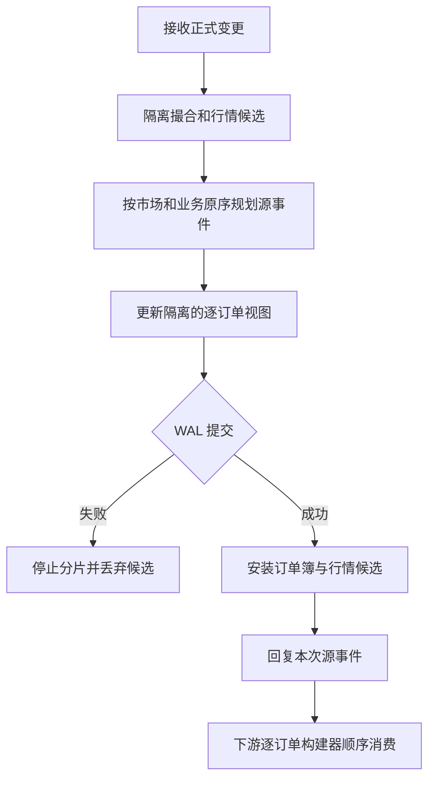

# 市场行情源与逐订单视图

正式持久命令在隔离候选中依据有序业务事件生成市场行情源。每个市场维护独立 `market_event_seq`；实际产生源事件时推进；正常业务拒绝、去重命中和无行情变化不会消耗市场源序号。旧格式快照首次初始化时，进入日志的业务拒绝也会触发下文所述边界和存量视图。批次在 WAL 提交后安装候选并回复。对应的逐订单构建器只在输出新增、减少或删除消息时推进 `mbo_seq`；成交和边界可使源水位前进而不改变逐订单序号。客户端应以自身 feed 序号检查缺口。

正式限价挂单的可见详情来自实际候选节点；止损 child 在真实挂入时捕获详情与事件边界，结算插入事件后重新映射边界。源事件只包含可见数量，冰山补量先移除耗尽片，再按实际顺序新增新片。旧格式快照没有行情历史；下一条进入持久日志的非去重命令（包括业务拒绝）会先为每市场发出显式边界，并按照真实价格档和 FIFO 链表顺序发出当时可见挂单，之后处理该命令。边界不表示已恢复旧格式不存在的历史行情。

源事件版本 `MSE1` 使用大端固定宽度编码：四字节魔数、四字节市场身份、八字节严格正源序号、一字节载荷标记。标记 `1` 为新增（订单身份、方向、价格、可见数量），`2` 为减少（订单身份、剩余可见数量），`3` 为删除（订单身份），`4` 为成交（成交身份、挂单身份、吃单身份、价格、数量、挂单方向），`5` 为边界。身份使用 16 字节，价格使用有符号 8 字节、数量使用无符号 8 字节，方向 `0` 为买、`1` 为卖。未知标记、零序号、非法价格或数量、截断和多余尾字节均拒绝；持久记录还须由其外层日志提供完整性与提交边界。

分片快照保存市场源水位及独立逐订单状态；恢复会验证水位、订单详情和价档 FIFO。检查点接受的外部水位必须由调用方从可信持久前缀取得，单纯传入数字不是持久性证明。当前尚未提供独立可订阅的持久行情源日志、消费者持久游标或历史源事件保留机制；因此不得把命令响应、内存检查点或匹配快照视为完整行情投递恢复方案。

`recover_market_data_from_genesis` 仅在尚未登记快照、完整创世 WAL 未被回收、调用方独占目录并提供原始可信配置时，借助严格清单重放已提交命令及其行情源。快照已登记时拒绝该入口，避免将旧格式升级的边界误构造成创世历史；损坏或缺失前缀同样失败。此入口不保存消费者游标，也不提供 WAL 回收后的历史。

`SnapshotImage::market_data_builder` 返回镜像中指定市场的逐订单状态副本；只有来自清单验证的快照才可作为持久恢复基线。从该基线按已提交 WAL 后缀重建的源事件依次推进构建器，可恢复对应源水位与逐订单摘要；内存屏障镜像本身不证明已持久。

`SnapshotRecoveryRecords::replay_market_data` 从经清单验证的快照提取指定市场视图，按已提交 WAL 后缀重建源事件并消费，最终逐字段核对视图；不存在市场或旧快照缺少行情视图时拒绝。返回的源片段从快照之后开始，不能证明或恢复之前的历史，也不是独立消费者持久游标。
