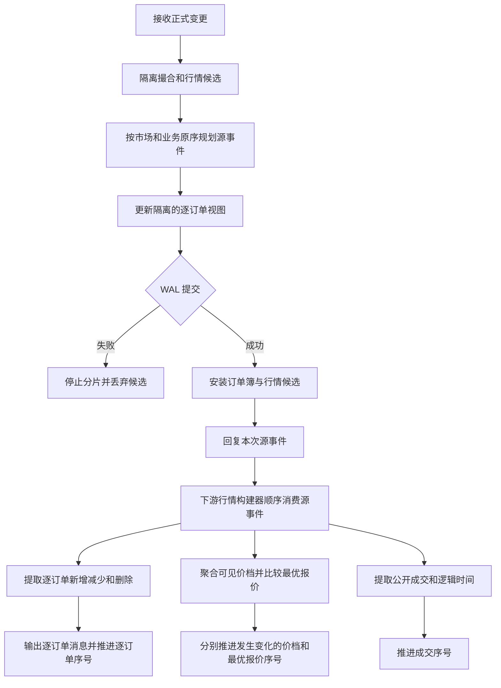
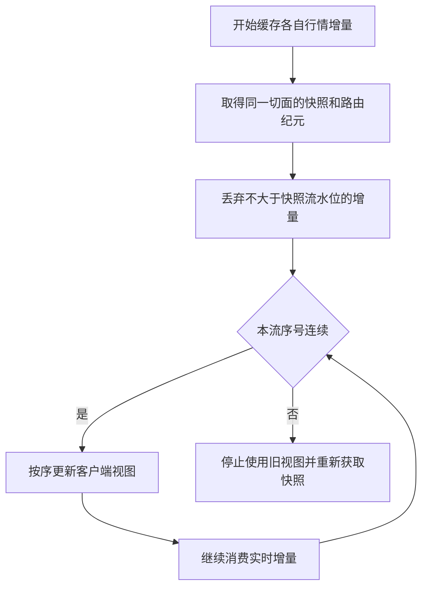

# 市场行情源与公开行情流

正式持久命令在隔离候选中依据有序业务事件生成市场行情源。每个市场维护独立 `market_event_seq`；实际产生源事件时推进；正常业务拒绝、去重命中和无行情变化不会消耗市场源序号。旧格式快照首次初始化时，进入日志的业务拒绝也会触发下文所述边界和存量视图。批次在 WAL 提交后安装候选并回复。对应的逐订单构建器只在输出新增、减少或删除消息时推进 `mbo_seq`；成交和边界可使源水位前进而不改变逐订单序号。客户端应以自身 feed 序号检查缺口。

正式限价挂单的可见详情来自实际候选节点；止损 child 在真实挂入时捕获详情与事件边界，结算插入事件后重新映射边界。源事件只包含可见数量，冰山补量先移除耗尽片，再按实际顺序新增新片。旧格式快照没有行情历史；下一条进入持久日志的非去重命令（包括业务拒绝）会先为每市场发出显式边界，并按照真实价格档和 FIFO 链表顺序发出当时可见挂单，之后处理该命令。边界不表示已恢复旧格式不存在的历史行情。

源事件版本 `MSE1` 使用大端固定宽度编码：四字节魔数、四字节市场身份、八字节严格正源序号、一字节载荷标记。标记 `1` 为新增（订单身份、方向、价格、可见数量），`2` 为减少（订单身份、剩余可见数量），`3` 为删除（订单身份），`4` 为不含时间的兼容成交（成交身份、挂单身份、吃单身份、价格、数量、挂单方向），`5` 为边界，`6` 在成交字段后追加八字节逻辑时间。正式执行投影使用标记 `6`；不含信封的低层投影仍产生标记 `4`，该标记可解码和供 MBO 消费，但缺少时间时 `FeedBuilder` 拒绝整次处理且所有行情流均不推进，不能凭空补时间。身份使用 16 字节，价格使用有符号 8 字节、数量使用无符号 8 字节，方向 `0` 为买、`1` 为卖。未知标记、零序号、非法价格或数量、截断和多余尾字节均拒绝；持久记录还须由其外层日志提供完整性与提交边界。

`FeedBuilder` 从空市场顺序消费调用方确认已提交的源，以逐订单状态聚合可见量。每条新增、减少或删除只改变一个价档；MBP 消息给出该档变化后的数量，零代表删除。BBO 比较双侧最优价格及该档可见总量；更深价档变化不会输出 BBO。MBO、MBP、BBO 和成交各自只在输出时递增独立序号，源序号用于追溯，不能用它检测过滤后行情的缺口。公开成交包含 `trade_id`、`market_id`、本流的 `feed_seq`、追溯用 `source_seq`、`price`、`qty`、`maker_side` 和正式信封的 `engine_time`，不包含订单或用户身份；成交身份不用于排序。输入不连续、非法变更、数量或序号溢出均整体拒绝，不推进任何水位。构建器和客户端恢复逻辑运行于进程内；持久行情游标和对外发布仍未实现。

行情水位、源缺口及构建器有效性的观测方式见[运行状态与管理审计](observability.md)。

消息字段 `source_seq` 对应规格中的 `source_market_event_seq`，只用于追溯；各行情流的缺口检测使用各自的 `feed_seq`。

分片快照保存市场源水位及独立逐订单状态；恢复会验证水位、订单详情和价档 FIFO。检查点接受的外部水位必须由调用方从可信持久前缀取得，单纯传入数字不是持久性证明。当前尚未提供独立可订阅的持久行情源日志、消费者持久游标或历史源事件保留机制；因此不得把命令响应、内存检查点或匹配快照视为完整行情投递恢复方案。

`recover_market_data_from_genesis` 仅在尚未登记快照、完整创世 WAL 未被回收、调用方独占目录并提供原始可信配置时，借助严格清单重放已提交命令及其行情源。快照已登记时拒绝该入口，避免将旧格式升级的边界误构造成创世历史；损坏或缺失前缀同样失败。此入口不保存消费者游标，也不提供 WAL 回收后的历史。

`SnapshotImage::market_data_builder` 返回镜像中指定市场的逐订单状态副本；只有来自清单验证的快照才可作为持久恢复基线。从该基线按已提交 WAL 后缀重建的源事件依次推进构建器，可恢复对应源水位与逐订单摘要；内存屏障镜像本身不证明已持久。

`SnapshotRecoveryRecords::replay_market_data` 从经清单验证的快照提取指定市场视图，按已提交 WAL 后缀重建源事件并消费，最终逐字段核对视图；不存在市场或旧快照缺少行情视图时拒绝。返回的源片段从快照之后开始，不能证明或恢复之前的历史，也不是独立消费者持久游标。

## 一致切面与续流

`FeedBuilder::l2_snapshot` 同时复制买卖价档、`mbp_seq` 和最后源序号；`l3_snapshot` 捕获逐订单状态及其 `mbo_seq`、源序号。调用方必须在同一单写者屏障取得可信 `route_epoch` 并传入，不能把独立时刻查询的路由与行情视图拼成一致切面。逐订单快照可有界编码并校验摘要；价档快照接收端校验价格顺序、数量和水位。快照及各自增量须在获取快照期间由调用方缓存，缓存必须有界；缓存溢出需要重新获取快照。

`L2Client` 与 `L3Client` 只用对应 feed 序号判断缺口，重复消息丢弃；源序号可跳跃，但新消息的源序号必须前进。检测到缺口后视图标记为无效，必须重新获取快照。`FeedCursor` 可用于 BBO 或成交的去重与缺口检测，缺口后的重放或重新订阅策略由调用方选择。客户端自行管理传输、缓存和重连；这些类型不提供服务端订阅或历史保留。

客户端读取 `depth` 或逐订单视图前应检查 `is_valid`；该标志只反映是否发现本流序号缺口，不证明消息来源可信，也不代替处理其他错误。`L3Snapshot::watermarks` 依次返回市场源和逐订单流的最后序号；`orders` 先列买侧再列卖侧，各侧按价格优先、同价按实际挂入顺序列出可见订单。快照摘要用于检测意外损坏，身份认证与完整性保护由传输层负责。

`FeedBuilder::encode_checkpoint` 的 `FDB1` 有界格式包含市场逐订单检查点、MBP/BBO/Trade 水位和 SHA-256 校验，解码重新聚合价档并验证序号关系。`recover` 要求调用方提供可信的已提交源后缀、最终持久水位和预期摘要，严格逐条重放并比较摘要；任一缺口、损坏、聚合溢出或不匹配均拒绝。摘要与撮合状态摘要独立。编码结果本身不是持久性证明。`write_checkpoint_file` 复用不可覆盖的快照文件写入、文件同步和目录同步；调用方须独占目录、只写已提交源状态，并在文件同步成功后登记可信文件身份和源水位。`read_checkpoint_file` 按该可信登记核对文件身份与水位；未登记临时文件不可作为检查点。调用方负责登记、在回收源历史前保证所需后缀可用及清理孤儿文件。当前未提供独立持久行情日志、检查点登记存储或持久消费者游标。

`FDB1` 依次保存四字节标识、带四字节长度前缀的 `MBO1` 检查点、三个八字节 MBP/BBO/Trade 水位和前述内容的 32 字节 SHA-256；整数均为大端。逐订单传输切面 `L3S1` 依次保存四字节标识、八字节路由纪元、带四字节长度前缀的 `MBO1` 检查点以及前述内容的 32 字节 SHA-256。两种编码均受调用方字节上限约束；校验和不是防篡改认证。

`migration_boundary` 从同一构建器状态取得市场源和全部 feed 水位，并记录调用方提供的原分片、目标分片和路由纪元。调用方须在迁移屏障确认它们与已提交市场状态对应；该值只是管理信号字段，不执行迁移或发布。检查点交接测试覆盖投影器源序号和行情流水位连续；真实跨分片迁移及其管理信号发布待迁移功能实现后验证。
