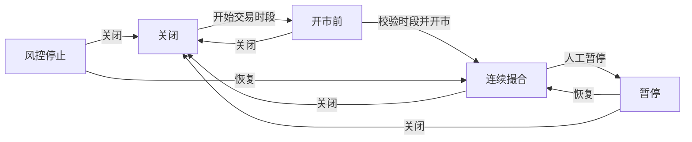

# 市场生命周期

`MarketLifecycle` 是不拥有订单簿或资金状态的纯领域状态；它保存市场状态与最近启动的交易时段。初始关闭状态可开始时段进入 PreOpen，匹配时段的开市操作可进入 Open；Open 可人工暂停，Halted 或 Suspended 可恢复 Open。非 Closed 状态可转换为 Closed，Closed 不能直接恢复交易。独立结束时段后，结束的时段不能再用于开市或恢复；应先关闭市场，再启动新的时段。

PreOpen 中的限价单必须由订单簿检查是否交叉；交叉时返回 `PreOpenWouldCross`。Open 接受限价，Halted 和 Suspended 拒绝新增但允许撤单，Closed 拒绝新增与外部撤单。

生命周期值本身不负责清理订单或释放预留；调用方须先在隔离候选中完成这些业务操作，再原子安装状态和订单簿。逐条同步与有限组提交入口已接入创建、开始时段、开市、暂停、恢复、结束时段及关市，并对正式限价单执行状态、数量和本金检查；完整市场管理尚未完成。开市和恢复会检查所需价格带参考价及边界的可表示性；开市时如果已有活单，还会核验簿与预留绑定，并检查普通挂单和 StopLimit 限价是否均在当前价格带内。PreOpen 参考价动态更新及同一 mutation 内的批量撤销仍待对应业务路径完成。

生产簿和参考簿分别提供会话终结与关市的候选计划：会话终结仅选择指定时段的普通 DAY 和 Stop-DAY；关市选择所有活动订单，DAY 按到期原因终结，其余按 `MarketClosed` 取消。事件按订单身份排序，计划记录前态并在应用前验证没有漂移，订单索引、簿和预留绑定后态一起安装。终结预留绑定仅迁入 PendingR2，不生成尚未发生的真实资金释放。关市计划和独立结束时段已接入逐条同步、有限组提交及重放，并持久化时段是否结束，避免后续关市重复发出 `SessionEnded`。

领域事件已定义市场创建、配置更新、状态变化、时段开始和结束，并在事件摘要中编码完整市场、状态、原因和时段字段；已接入的管理命令会在逐条同步、有限组提交和重放时产生相应事件；配置更新支持普通活单符合新数量及本金限制、活单存在时移除价格带、在相同参考来源下放宽偏离范围，或在新参考价有效且全部普通挂单和 StopLimit 价格均落入新边界时收紧偏离范围、启用价格带或切换参考来源，以及暂停且空簿时的 tick/lot 变更。已有参考价时会在候选中预检价格带边界的可表示性。优先级保护策略更新时分别保留普通和 Stop 的下一序号；任一序号超出新策略边界则拒绝并保持原状态，快照校验策略与持久市场配置一致。StopLimit 活单按触发价对齐、完整数量和限价本金检查；StopMarket 基础数量单允许在本金范围不收紧时变更数量限制，并校验数量和 lot；报价预算单允许数量范围和最小本金不收紧；最大本金若收紧，不得低于订单预算，因成交本金不会超过预算；保持或放宽原上限可沿用已有订单。更严格的配置需要能够验证市价订单的可执行本金，当前保持失败关闭。StopMarket 限制变化、费率版本及 scale 的完整更新能力仍待接入。

`validate_market_math_update` 接收已分别通过 `MarketMath` 构造校验的新旧配置：存在活动订单或被引用的历史金额时拒绝更改 scale；变更 tick 或 lot 须处于 Suspended 且无活动订单。调用方必须提供可信的订单和历史引用状态，并负责校验其他配置、预检与持久提交；市场更新命令校验普通活单、Stop 活单及已持久化的历史引用标记；接受正式订单后该标记永久置位，并保守检查优先级历史及现有参考价。旧版管理快照一律按存在历史引用恢复。没有历史引用且资产精度不变的市场可更新价格精度；基础资产及报价资产精度更新仍待接入。

`MarketConfig` 在领域层表示市场精度、tick/lot、订单限制、价格带、费率版本、关市策略和执行边界。静态校验复用 `MarketMath` 检查最小 tick×lot 本金的精确表示，同时检查上下限、价格带基点和优先级保护空间；版本化配置编解码在恢复时重新执行同样的校验。已创建市场的配置纳入分片快照和状态摘要；真实版本化费率簿及资金结算仍由后续功能负责。

`ManagedMarket` 将已校验配置与生命周期组成独立候选，可按协议顺序产生启动时段、开市、暂停、恢复和关市的状态事件。创建时段要求调用方确认普通簿和 StopBook 均为空；开市和恢复在启用价格带时要求可信参考价，开市还需确认重校验完成；关市只在调用方确认候选清理完成后改变状态。配置更新的订单、历史和费率校验结果须由同一单写者的可信状态产生；候选本身不会访问费率服务或持久写入。逐条同步与有限组提交路径已持久化该类型；有 WAL 的恢复入口支持重放，进程内恢复入口暂不支持受管理市场。

包含 StopLimit 和 Stop-DAY 的快照候选已验证配置更新、关市或时段结束后的订单事件、预留状态及重放摘要；该验证使用编码后再解码的管理命令，不代表 Stop 下单已经接入正式 WAL。

数值配置校验保留 tick、lot、精度、非整数本金和溢出的内部错误分类；管理命令将这五类分别映射到稳定拒绝码 1011–1015，价格带基点越界映射到既定的 `InvalidSlippageBps`（3007）；错误配置命令仍进入 WAL 并在重放中产生同样的拒绝事件。

正式限价命令的候选事件在提交前核验单命令成交数量；超过市场上限时分片停止，候选不写入 WAL 或发布。止损触发级联的内部动作上限尚需在对应正式级联入口接入。

当前 `CreateMarket` 要求调用方事先配置同分片的路由、空订单簿和匹配的可信预留策略；它持久创建生命周期与市场配置，不会动态创建路由或风险策略。需要先通过 `CreateMarket` 建立市场的持久分片，应在可信 `PlaceSupportConfig` 上调用 `require_managed_markets`：未创建市场的订单查询返回 `MarketNotFound`，正式下单和市场范围撤单产生 `MarketNotFound` 业务拒绝；已创建但关闭的市场产生 `MarketClosed`。拒绝与去重结果纳入 WAL 和重放。旧版配置默认保留非托管入口兼容；严格模式不能用于不具备持久市场管理的进程内启动入口。
