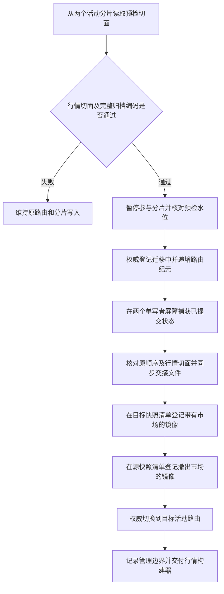

# 停市迁移

市场迁移通过两次持久路由 CAS 转移写权。管理端使用 `MigrationStorage::migrate`，有租约的路由权威使用 `migrate_monitored`。两次调用或进程重启之间，用相同的集群、市场、源分片、目标分片、旧路由纪元、快照身份和持久目录识别同一次操作。

管理端先在活动路由上读取源、目标快照，核对逻辑时间、验签密钥、费率配置、目标幂等窗口和活动订单容量。它在内存中模拟冻结和状态转移，核对行情构建器，并按 `MIG1` 格式编码两侧镜像、行情检查点和归档字段。行情切面不一致或整份归档超过 `max_bytes` 时，原路由和两侧分片仍可写入。调用方可以补齐行情、调整归档容量后重新预检。

首次冻结要求路由表中的市场均为活动状态。预检通过后，协调器暂停源和目标，在两侧队列的屏障处核对水位。如果任一分片已执行新命令，协调器核验原路由、恢复两侧准入并返回 `WouldBlock`。调用方更新行情切面后可按原身份重试。水位吻合时，第一次 CAS 将市场登记为迁移中，所有者仍为源分片，`route_epoch` 加一。

迁移期间，源和目标冻结整个分片的业务变更，使用户控制、资金登记和其他市场的状态与完整分片快照处于同一切面。旧纪元请求返回 `StaleRouteEpoch`。携带新纪元、发往源或目标的该市场请求返回 `MigrationInProgress`。参与分片上的其他业务变更返回 `EngineBusy`。这些拒绝都发生在分配业务序号之前。其他分片可以继续服务。迁移控制消息使用已有的有界队列。

**订单簿与身份。** 两侧分别保留自己的 `shard_seq`。目标保留价档和止损队列原有的 FIFO 顺序，以及到期索引、交易时段、管理配置、预留状态和客户端订单索引。普通挂单和止损单分别从原有的 `next_queue_priority` 和 `next_stop_priority` 继续分配优先级。源分片保留其他市场的数据。迁移保留原命令、会话别名和首次执行序号。切换后用新纪元重试相同命令，可以命中原窗口并返回原结果。用户控制下限合并到目标并保留较高值。金额沿用原有的资产和精度契约。

**行情。** 首次交接需要已消费至源屏障的可信 `FeedBuilder`。管理端逐字段核对其逐订单投影和撮合快照，连同两侧镜像保存完整构建器检查点。目标从下一条 `market_event_seq` 继续消费。MBO、MBP、BBO 和 Trade 各自从原有的 `feed_seq` 续接。操作完成后，`read_boundary` 可以按迁移身份读取切换后的管理记录，包括两侧分片、目标纪元、最后源序和各行情流水位。

**持久目录与恢复。** 调用方事先准备源和目标各自正常恢复使用的快照目录，以及单独的迁移归档目录。这三个目录须彼此独立并受访问控制，两侧各指定一个可用的快照文件身份。管理端在操作目录持锁，先同步整个归档，再由目标、源分片依次在各自当前持久水位登记新镜像。目标登记成功后仍保持停写。两端均已安装，协调器才通过第二次 CAS 将同一纪元的所有者切换到目标。

已入队操作等待回复超时，结果可能未知。重启或重试时按同一迁移身份读取权威路由和归档。

| 权威路由 | 续办动作 |
| --- | --- |
| 原纪元、源分片活动 | 重新预检。此时若已存在整份迁移归档，报告冲突。 |
| 本次迁移中 | 有归档时校验并复用归档。尚未形成归档时，需要与冻结屏障一致的可信行情构建器重新生成。两侧安装均可重试。 |
| 本次目标已活动，或该市场已进入更晚纪元 | 从原归档恢复历史切面，仅补记并返回本次切换边界。缺少原归档时返回错误。 |

归档需保留到所有续办完成。从历史归档返回的构建器对应当次切换水位。已处理后续消息的行情服务继续使用自己的最新检查点。

归档 `MIG1` 依次保存集群、市场、源、目标、旧路由纪元、双方快照文件身份、市场摘要、最后市场源序、`FDB1` 行情检查点和两份完整分片镜像。使用有界大端编码及快照文件的外层 CRC32C。管理记录 `MBD1` 绑定集群、市场、两端分片、目标纪元、最后市场源序及四个独立行情流水位。迁移在各分片当前持久序号建立新基线，并从清单中移除跨所有权的旧快照后备项。重试若发现同名已发布文件，其身份、序号和载荷必须完全相同才能复用。

源和目标均须使用 `LocalDurable` 的持久正式分片，支持 `FsyncEach` 和 `GroupCommit`。安装镜像前，分片确认没有待提交批次，镜像序号等于本分片的已提交前缀。现有 `StandbyDurable` 接任从创世 WAL 验证权威状态，尚无权威复制的迁移快照，因此迁移在首次路由 CAS 前返回 `Unsupported`。对应的快照与行情格式见[分片快照](snapshot.md)和[市场行情](market_data.md)。
