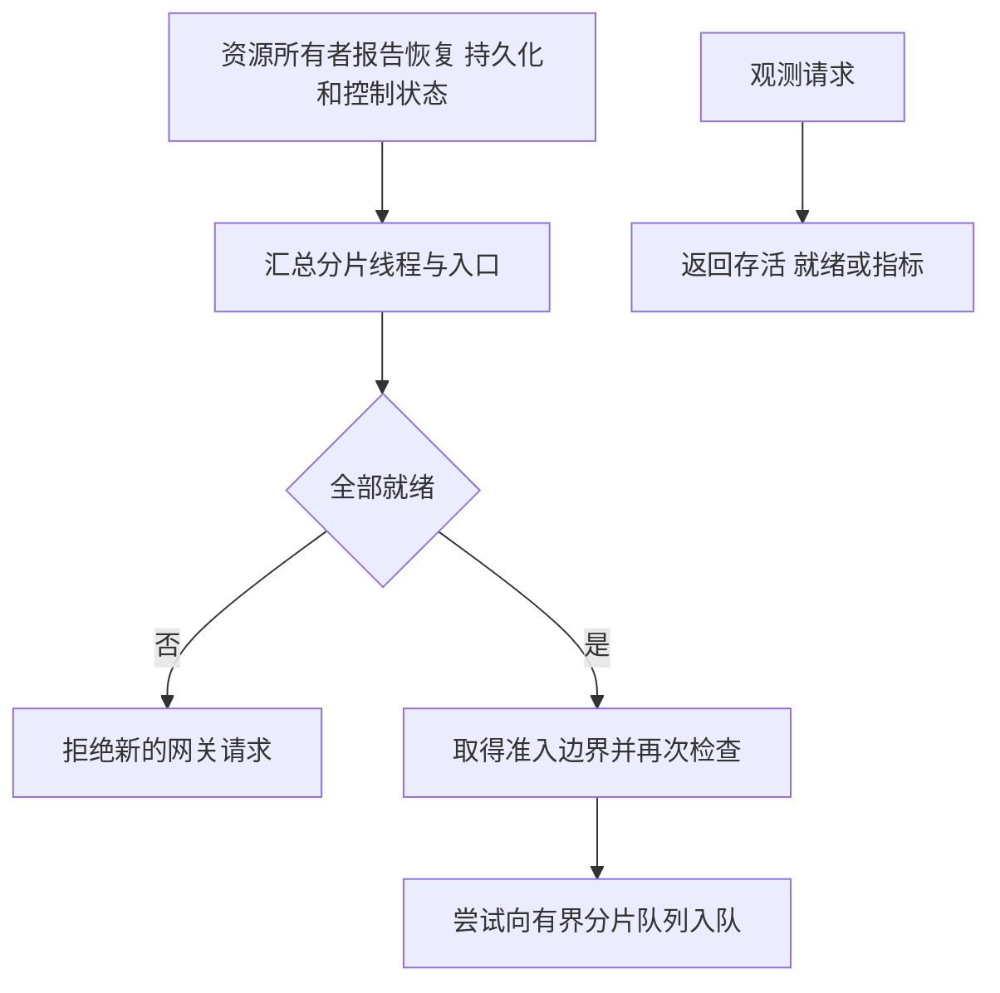

# 运行状态与管理审计

## 健康与准入

`Health` 汇总实际分片线程和有界入口状态，恢复、持久化和控制条件初始均为不健康。部署方须由相应资源的所有者及时报告状态；此接口本身不能证明外部租约、事件日志或复制状态。所有健康对象须覆盖网关实际使用的同一组分片。依赖转为不健康与网关最终入队通过短临界区排序；已经入队的请求仍按原有持久化和失败语义处理。

分片级熔断激活时保持存活但不再就绪；熔断状态在持久批次安装后、回复前发布，恢复时从重放状态初始化。解除熔断后的就绪仍须满足其他依赖。管理控制入口须保持可用，以便排查与解除熔断。

要求本地主节点租约的部署应使用 `Health::new_primary`：每个分片必须具备本地持久写入和启动时按集群、分片、纪元校验过的租约。健康对象只持有租约弱引用，不延长租约或分片的生命周期；分片停止、失败或关闭入口即不再就绪。此租约依赖调用方保护可信单机文件和锁，不是跨主机租约。

`serve_http` 对单个已有双向流处理有界请求头，并提供 `/live`、`/ready`、`/metrics`；调用方负责监听、连接超时、访问控制和连接关闭。`/ready` 额外报告 `durability=ephemeral`（任一受监测分片没有本地 WAL）或 `durability=local`（全部有本地 WAL）；后者不证明备节点或跨主机高可用。状态转变后的观测是并发快照，队列数值可随读取变化。

## 指标

队列深度与容量是所有受监测分片的瞬时合计。`engine_queue_wait_us` 测量每条成功入队消息从入队到出队的时间，覆盖变更、查询和控制消息；入队失败不计样本。`engine_commands_total` 统计已有最终回复的正式命令和低层变更，包含幂等命中；`engine_reject_total` 统计其中的入口或业务拒绝；`engine_trades_total` 按实际结果中的真实成交事件计数，不重复计入幂等回复。`engine_match_latency_us` 测量分片内限价或市价撮合候选处理，包含拒绝和幂等命中的候选检查，不包含队列等待及批次同步；正式批次在候选生成后立即采样，因此提交失败的候选也可能留下样本。`engine_wal_append_latency_us` 和 `engine_wal_fsync_latency_us` 分别测量写入器实际追加和同步调用，包含失败调用；已注册写入器的同步耗时包含清单持久登记。`engine_snapshot_duration_ms` 从后台写入器取出请求开始计时，到文件写入和清单登记结束为止；`engine_snapshot_failures_total` 记录已接收请求的失败次数，不包含入队前被拒绝的请求。直方图使用本地单调时钟，名称中的单位分别为微秒或毫秒，互斥桶在输出时转换为累计桶；各原子值的并发读取不构成一致切面。计数是进程生命周期内的观测，不写 WAL，不作为恢复依据；溢出时保留原值并设置 `engine_metrics_overflow`，汇总本身溢出时返回错误。内存分片不输出 WAL 直方图。其他组件指标仍未全部覆盖。

`engine_command_latency_us` 从成功入队前的投递尝试开始，到最终回复交付前为止，包含队列、批量等待与持久化；未入队和线程失败后无回复的命令不计样本。`wal_group_commit_batch_size` 统计每次非空批量同步尝试的记录数，`wal_group_commit_wait_us` 统计首条成功追加记录到同步尝试开始的等待；同步失败也计样本，逐条同步不计入批量样本。`engine_replay_records_total` 和 `engine_replay_duration_ms` 仅在本地分片成功重放并启动后记录其恢复后缀及纯重放耗时；恢复失败或独立重放接口不计入已启动分片。

`engine_open_orders` 包含普通挂单和未触发止损单，`engine_price_levels` 包含普通买卖价档。读取指标时通过有界查询队列在各分片顺序点采样，最多等待每个分片一秒；查询繁忙、关闭、超时或汇总溢出时 `engine_book_metrics_available=0`，不输出不完整的订单簿规模。采样不占 durable 序号，但会占用查询队列并遍历市场，调用方应限制抓取频率；多个分片的结果并非同一原子切面。

调用方可通过 `Health::with_priority_markets` 显式选择最多 1024 个市场，输出各自的下一普通和止损优先级、累计分配数以及剩余空间估计。累计分配数取各自持久状态的下一优先级，恢复后不会重置；`priority_space_exhaustion_total` 统计本进程实际返回的耗尽拒绝，不重复计入正式幂等结果。所选市场不存在、重复归属或查询失败时，`engine_priority_metrics_available=0`，不输出部分市场指标。`u128` 以十进制输出；Prometheus 浮点存储可能损失大整数精度，不能用指标作为权威分配状态。

`FeedMonitor` 接管一个市场的 `FeedBuilder`，在成功消费源事件后发布市场源水位和 MBO、MBP、BBO、Trade 各自的流水位；源缺口会增加计数、保留旧水位并标记构建器无效，之后必须从可信前缀重建。`Health::with_feeds` 只有在调用方明确登记时才输出这些指标，拒绝重复市场，并要求配置市场数量上限（最多 1024），以控制标签基数。观测句柄不证明数据已持久或已发布；独立使用构建器时，调用方须自行响应无效状态。通过网关交接回调消费时，返回错误将关闭网关就绪，恢复完成前不得重新开放。

`FeedCursorMonitor` 包装现有客户端本流去重游标；调用方显式标识行情类别并通过 `Health::with_feed_cursors` 登记，按固定的 feed 标签汇总实际检测到的流水位缺口。重复消息和市场身份错误不计入缺口，同一缺口反复提交会分别计数；未登记的游标及未使用该包装器的其他客户端不在统计范围内。游标数量有配置上限且最多 1024，重复登记同一观测句柄会被拒绝。

## 审计

`AuditLog` 是单机独占、有容量上限的管理日志，使用固定字段、CRC 和独立清单确认同步前缀。管理入口先持久记录操作意图，再派发，随后记录成功、拒绝或结果未知；崩溃或等待超时后的未决意图必须用原命令身份核对业务 WAL。快照和认证失败有独立审计入口，认证失败记录不包含密钥或口令。调用方负责身份认证、授权、保护日志及其清单目录，并确保管理操作采用审计入口；底层分片 API 本身不强制审计。CRC 用于检测意外损坏，不是防篡改认证；审计日志不能替代业务 WAL。

审计入口覆盖市场配置与状态、参考价格、费率、熔断开关、用户栅栏和管理发起的批量撤单；记录关联命令身份、集群与分片、适用的市场和路由纪元，以及分片控制命令预期的主节点纪元。`acquire_primary` 在尝试获取前记录意图，在成功后记录实际纪元；结果记录无法同步时不会向调用方交付租约，但已持久推进的纪元不会回退。租约或快照 I/O 返回错误时可能已有持久副作用，审计结果保守记录为未知，调用方须检查权威存储；入队前明确拒绝才记录拒绝。`AUD2` 格式采用大端整数，文件头后为固定长度记录：操作者和操作身份、类别与结果、带存在标志的市场/路由纪元/主节点纪元/集群分片、规范命令摘要及 CRC32C；可选字段缺省时其数值字节为零。恢复只接受清单确认的完整前缀，截断未确认尾部，拒绝已确认记录缺失或损坏。日志和其旁边的清单目录必须一并保护。

分片将 WAL 追加、同步、单条提交、快照清单登记和未归类线程异常写入固定容量诊断队列。记录仅含故障类别、集群、分片、已知命令身份和分片序号，以及适用的 I/O 错误类别，不携带认证凭据、原始业务载荷或任意错误文本。`WalAppend` 描述追加调用路径，自动触发的批次同步失败也可能在此路径返回。消费者通过 `take_diagnostics` 读取；队列满时不阻塞撮合线程，丢弃次数通过 `engine_diagnostics_dropped_total` 暴露。诊断是有损进程内信息，不是审计记录或持久性依据，部署方须在外围收集并告警。

## 端到端验证边界

自动测试以真实 TCP 连接向网关发送协议帧，经认证、持久身份绑定、风险令牌和正式分片产生成交。连接线程在回复前通过 `serve_with` 将已提交结果交给外围，测试即时构建公开行情并核对结算事件；重试返回去重结果，不重复产生成交。关闭分片后从已确认 WAL 创世前缀重建业务事件及公开行情，对照实时结果、成交身份、价格数量和参考账本中的结算变动。测试分别执行逐条同步和批量同步；另注入交接失败，验证无成功回复、就绪关闭及 WAL 恢复。

回调运行于网关连接线程，不运行于分片撮合线程；失败时命令可能已经持久提交，网关关闭就绪并返回交接错误，客户端须保留原身份，外围须先恢复并核对持久前缀才能重新开放。调用方负责有界背压、跨连接按分片序号排序、消费幂等及回调失败后的恢复；进程内交接不能替代持久事件日志。当前仍不提供独立持久行情源日志、消费者游标或独立实时对外发布服务。
