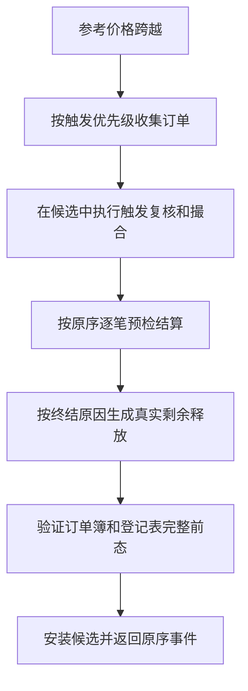
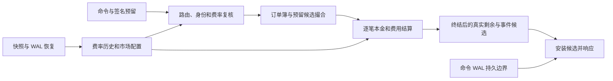
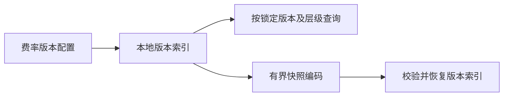

# 风险与结算管线

当前本地预留登记保存订单与多资产预留的绑定，并支持签名验证、覆盖检查和 PendingR2 归属。PendingR2 不代表资金已经释放或结算。独立 R2 预留候选可按预留与资产聚合扣减，验证覆盖和版本、检测提交前漂移，并在终结时记录真实剩余释放；订单簿可在独立副本中按候选同步活动预留影子并验证前态。启用费率簿后的正式限价下单、批量撤单与市场时段结束/关闭在候选中组合相应结算或释放；此前等待处理的历史 PendingR2 不自动释放。已释放预留允许空余额，活动预留仍要求非空正余额。

资产原子单位换算使用严格整数运算：扩大精度时检查因子和乘积，缩小精度时要求完全整除。该函数已接入成交结算候选。

本地费率簿保留不可变的历史版本，并按版本和层级确定性查询。每个版本保存费用资产策略、挂单方与吃单方费率以及实际费用的取整方向；更新必须使用更大的版本号。首次更新可同时提供升序的历史配置，以原子初始化多个市场既有订单所引用的版本；后续更新不允许携带历史。缺少活动预留（包含 PendingR2）或市场配置引用时整体拒绝，不安装不完整的费率簿；快照恢复同样检查活动预留的版本和层级。费率簿可独立进行有界快照编解码，恢复时检查顺序、数量、版本及字段标记。费用计算按有符号基点计算正费用或负返佣，使用配置的方向取整并检查整数范围。费率版本更新已接入有市场路由的持久命令、分片快照与 WAL 重放；逐条同步与有限组提交先在独立候选中安装并仅在持久提交后发布。受管理市场的新单使用市场配置指定的版本，非受管理市场使用费率簿活动版本；已有订单继续使用接收时锁定的版本。

成交预检以挂单方视角输出基础资产和报价本金的相反方向变动，并分别使用双方预留锁定的费率版本及层级计算费用；SettlementDelta 载荷在各自 FeeDelta 保存版本与层级，避免双方历史版本不同时丢失信息；本金与费用分开，资产精度无法精确映射或有符号金额不可表示时拒绝。第三资产可使用随费率版本持久化的报价资产身份及正有理比例，按资产原子单位精确换算；旧版无比例的第三资产配置仍明确拒绝。

成交 R2 预检可将双方本金支出、同资产所得抵扣后的正费用以及订单终结释放组合成登记表候选；手续费不能以其他资产所得抵扣，预留不足时不改变任何状态。已接入正式限价单的成交及正式批量撤单的真实剩余释放，并与命令 WAL 一起恢复。

版本费率限价下单候选按 maker/taker 正费率较大者逐最小 lot 向上取整，验证签名预留的资产覆盖。基础资产费用在卖方本金之外预留，报价资产费用在买方本金之外预留；可从同资产成交所得扣除的部分不重复预留。卖方第三资产费用或超过所得的报价费用按价格类型可表示的最大合法 tick 计算保守上界，必要时返回算术溢出，实际部署可能需要大量预留。第三资产配置同时要求最小 tick × lot 的精确换算，以保证合法价格和数量的组合可表示。已接入的正式限价命令和测试中的多笔成交、自成交防护使用同一候选；正式 Stop、Amend 与其他尚未开放的命令不属于此路径。

自成交防护终结订单的真实剩余使用新增稳定原因 `SelfTradePrevention = 1309`；被拦截部分不生成 Trade 或 SettlementDelta。

止损 child 的本地复核可在触发回调中检查订单、用户、市场、活动预留及接收时锁定的费率版本与剩余资产覆盖，旧版本仍按原版本计算；不足时在 child 撮合前拒绝。基础数量市价 child 使用调用方已冻结的有效最差价；没有保护价时，按方向使用可表示的保守价格边界。报价预算 child 使用最小可成交本金划分预算来覆盖成交分拆费用。生产订单簿提供止损级联及真实 R2 的隔离候选：逐笔成交生成结算载荷，终结时释放实际剩余；完整前态漂移或预留不足时不安装状态。游标候选只为实际成交生成 TradeId，失败时不改变调用方的簿、登记表和游标。参考价持久命令已接入该候选并复核市场状态；相关回放目前从带 Stop 的可信快照构造，正式 Stop 下单持久入口仍未开放。原有低层兼容接口仍只迁移 PendingR2，不代表真实结算。

候选的非空真实剩余可转换为 `ReservationReleased`：包含订单、预留、释放原因以及按资产排序的实际金额。旧版独立止损路径仍使用不含金额的历史载荷，不能将其视为真实 R2 释放；事件摘要对旧载荷保留原编码，对带金额载荷使用独立标记。转换本身不提交状态或发布事件。

内存 Reference Ledger 仅供验证：它可消费结算事件，在副本中合并双边本金、费用账户和返佣的变动，检查余额与溢出后一次安装，并拒绝重复成交。它不连接生产账户系统，也不自动消费 WAL。

图中候选与 WAL 均须完成后才能安装；逐条同步和组提交在候选计算与持久写入的具体时点上各有流程。历史 PendingR2 与尚未开放的正式命令不由这条已接入的下单路径自动处理。

