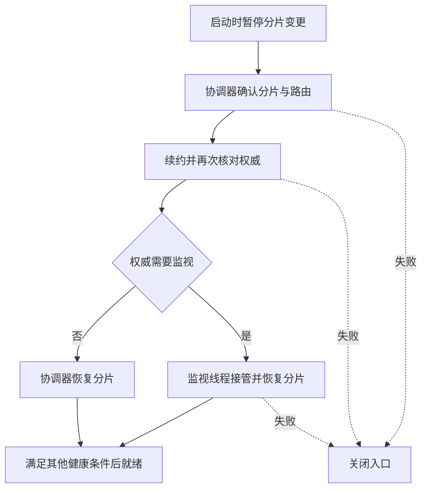
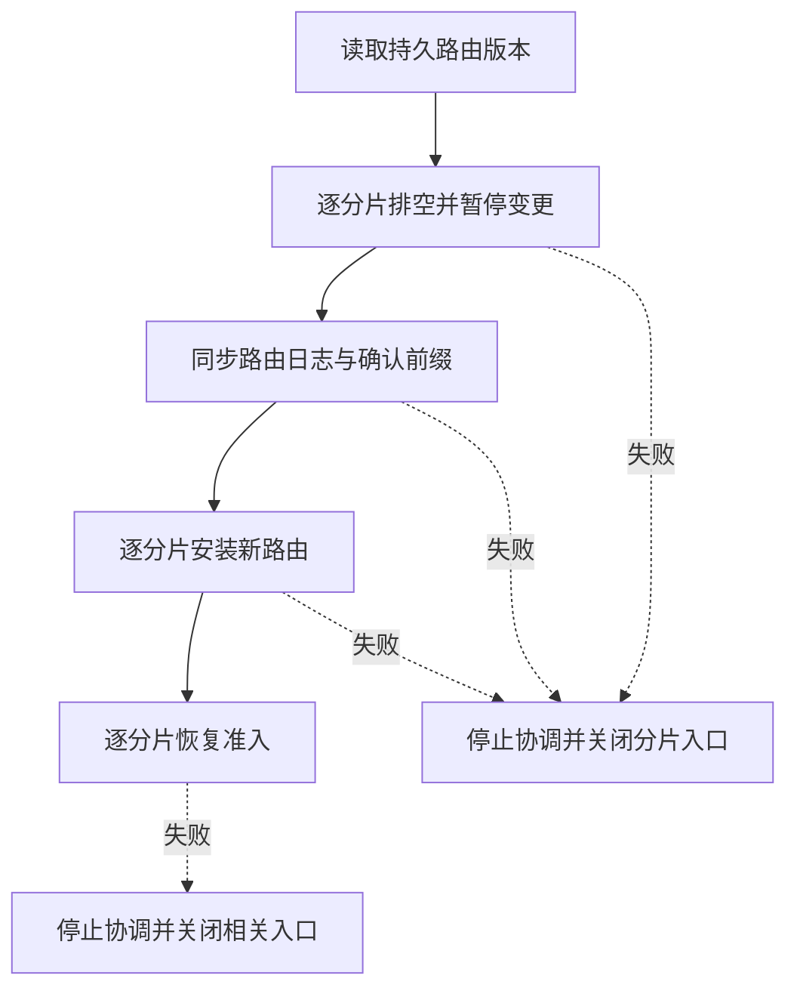

# 单写者分片运行时

当前 `matching-runtime` 提供进程内单写者分片执行；以下描述当前支持范围，不代表持久化或高可用能力已经完成。

健康准入、指标采样、管理审计及端到端验证边界见[运行状态与管理审计](observability.md)。

## 所有权与入口

`Shard` 启动时把市场本地 `ProductionOrderBook` 移入工作线程。工作线程是撮合状态的唯一持有者；`ShardHandle` 可以克隆，只能提交消息，不能直接读写订单簿。旧低层模式拒绝带预留影子的订单簿；正式模式须提供已绑定市场的订单簿、完整预留登记表及可信初始逻辑时间。两者均检查市场与显式路由。进程内所有权表阻止同一 `ClusterId` 下重复启动相同 `ShardId` 或重复持有相同 `MarketId`；表只在本进程生效，不是跨进程锁、持久租约或主节点 fencing。锁仅保护所有权和队列准入元数据，不保护订单簿。

`crossbeam_queue::ArrayQueue` 本身是 MPMC 队列；代码通过不公开、不可克隆的消费者端将它用于多生产者、单消费者。容量固定，查询和控制消息分别受配额限制，并共同保留供变更使用的空间。外部提交只尝试一次；容量不足、配额不足或准入锁竞争均可能返回 `ShardError::Busy`，故 Busy 不一定意味着队列已经满；`ShardError::ingress_reason()` 将其映射为稳定拒绝码 `EngineBusy = 5002`。入口关闭返回 `Closed`，工作线程失败返回 `Failed`。成功入队后唤醒工作线程；BusySpin、Yield、Park、Hybrid 只影响线程等待，不作为业务时间。

查询和控制配额统计的是**排队消息**，由唯一消费者取出时释放；它们不是对调用方持有的所有响应的全局数量限制。每次响应使用容量为一的一次性通道，工作线程只发送一次；接收方未读取或已丢弃不会要求工作线程等待接收方。预留槽只限制查询和控制占用空间，变更自身仍可能填满队列；当预留槽等于总容量时，外部查询和控制不能入队。

## 路由、序号与成交身份

`MutationEnvelope` 保存调用方的 `CommandId`、`MarketId`、`route_epoch` 和载荷。`Router` 用显式 `RouteTable` 查找分片，校验快照及调用方版本，按原值转发版本；目标工作线程在分配序号前再次检查市场、所属分片、版本及迁移状态。入口或路由拒绝不分配序号，也不产生业务事件。直接使用 `ShardHandle` 时仍经过目标工作线程的校验。

`RouteControlStore` 在可信单机目录维护有界路由日志；带校验的日志头绑定集群身份，每次同步完整表，再通过独立清单确认持久前缀。恢复拒绝身份不匹配及已确认记录缺失或损坏，并截去未确认尾部；文件锁与进程内协调器登记不提供跨主机复制或租约。`RouteCoordinator` 核对集群、分片身份及持久路由，在各队列的顺序点暂停变更，完成旧批次后提交路由版本，重新读取确认后向所有分片安装并恢复。屏障及安装不占业务序号；暂停期间变更返回 `EngineBusy`。协调失败后实例停止并关闭关联入口；协调器退出时关闭入口，后台持有控制权威直到已接受消息排空。无法建立或完成排空时保留权威，须通过进程恢复处理；调用方仍须显式关闭工作线程。当前只允许已有市场保持 owner、活动状态且版本不倒退，不实现市场迁移。调用方须提供受保护的控制存储目录并确保跨进程采用同一权威。

`RouteAuthority` 允许注入外部路由权威，接口要求线性一致读取、持久 CAS 和有效所有权；`verify_authority` 核验版本和分片快照，读取失败或观察到外部版本变化会关闭相关入口。`matching-control` 提供 etcd 适配器和租约监视，使用方式及失权窗口见[外围控制存储与游标](control_store.md)；这些能力尚不能保证跨主机失权与持久提交原子 fencing。正式命令分片可启用 `PlaceSupportConfig::require_route_authority`，使创建和恢复后的工作线程在协调器确认权威前拒绝变更；该可信配置须在每次恢复时重新提供。低层分片通过 `ShardConfig::require_route_authority` 启用启动暂停；需要监视的权威会拒绝未从暂停状态启动的分片。

本机路由日志头依次为 `RTC2`、大端 `u16` 集群身份和覆盖前六字节的 CRC32C。每条记录依次为大端 `u32` 载荷长度、完整路由表和覆盖长度及载荷的 CRC32C；路由表以大端 `u32` 市场数量开头，按市场身份严格升序保存 `u32` 市场、`u16` 分片、`u64` 版本和一字节状态。活动状态为 `0`；迁移状态为 `1` 并追加源和目标的两个 `u16`。恢复同时检查记录完整性、排序、数量和受信集群身份。日志记录的数量由独立清单中的已确认前缀决定；完整但未确认的尾部也不视为已提交。

空状态分片的序号从 1 开始，只有通过前置校验并进入业务执行的 Mutation 分配序号；业务拒绝也保留已分配序号。Query 和 Barrier 不分配序号。正式命令的 `CommandId` 在分片内有界窗口用于去重；旧低层 Mutation 不提供去重。LocalDurable 恢复入口验证快照及已提交 WAL 后恢复序号和去重窗口，再从持久水位继续；调用方须确保目录独占与可信身份，进程内所有权不构成跨进程 fencing。

持久分片在打开或恢复 WAL 前，锁定其规范目录旁的 `目录名.tide-wal.lock`，直至写入器关闭；两个遵守此约定的分片不能同时占用同一 WAL 目录。锁文件和目录的真实身份须由部署方保护，该本机文件锁不是跨主机主节点租约。

根变更使用一个命令范围的 `TradeIdCursor`：字段依次为 `cluster_id:16`、`shard_id:16`、`shard_seq:64`、`trade_index:32`。索引从零开始，只为实际计划的 Trade 递增；订单簿组合 API 中同一根命令的冰山补量与 Stop 后代共用游标；当前正式限价下单在 StopBook 非空时拒绝，不执行 Stop 后代。游标耗尽返回 `ArithmeticOverflow`，候选失败不安装订单簿状态和游标；若已进入业务执行，分片序号仍被消费。旧订单簿接口仍保留调用方提供 TradeId 切片的契约。

## 已接入的业务和查询

| 入口 | 当前语义 |
|---|---|
| `Mutation::Place` | 使用现有 GTC 游标入口，支持该入口已实现的 STP，返回原序撮合事件。 |
| `Mutation::Cancel` | 使用低层普通订单取消入口，返回移除的 `OrderNode`，不构造 `OrderCanceled` 或资金释放事件。 |
| `Mutation::MarketByBase` | 使用基础数量市价游标入口，返回实际执行结果；调用者提供市场数值规则。 |
| `order` | 通过同一队列读取指定市场中的普通订单节点；未知订单返回空；该分片未持有的市场返回 `MarketNotFound = 1001`。 |
| `barrier` | 在同一队列读取请求身份和此前已执行变更的序号水位，不占序号。 |
| `take_snapshot` | 在同一队列复制分片状态为独立内存镜像，不占序号；可交给后台写入器并通过清单提交。 |

`order` 在工作线程处理该消息的位置读取，因此能看到其前面已处理的变更，不能看到排在其后的变更。屏障确认此前入队的消息已处理并已尝试回复，不代表调用方已经读取响应。水位是此前已完成且已分配的最大进程内变更序号；路由等前置拒绝不占序号，进入业务执行后的拒绝占序号；`0` 表示尚未分配。水位不表示磁盘持久化。未实现的批量查询和在线摘要控制消息不返回虚假的空结果；快照镜像可计算状态摘要；LocalDurable 恢复入口可回放已提交 WAL 并续写，在线摘要控制尚未实现。

登记表模式支持市场范围和指定来源会话的单市场正式批量撤单、预留查询及分片内用户 FenceOnly；显式配置下支持普通限价 GTC/PostOnly；持久入口另支持部分市场管理、参考价、市场熔断和开关命令。分片开关须绑定可信本机排他租约；可信配置选择 `require_managed_markets` 后，未创建市场的业务变更被持久拒绝。具体边界见 [市场生命周期](market_lifecycle.md)。正式 Market、Cancel、Amend、CancelReplace 与 Stop 命令尚未开放，FenceAndCancelAll 仍拒绝；旧低层取消不能替代真实预留归属迁移。正式模式的身份、候选提交与 PendingR2 语义见 [命令与事件身份](command_event_protocol.md)。当前不提供完整订单列表、深度或市场状态查询。

## 关闭和失败

`shutdown` 先关闭外部准入，再在截止时间前入队内部终止屏障并唤醒线程；屏障之前已入队的消息按队列顺序处理。成功确认后等待工作线程退出并 join；超时或异常明确返回错误。丢弃 `Shard` 会关闭入口并请求工作线程排空后退出，但调用方只有显式 `shutdown` 才能获得完成或失败结果。线程异常会关闭入口并标记失败，不自动创建空订单簿继续接单。

提交成功表示消息已进入队列，并不保证路由校验或业务执行成功。入队成功后调用方等待超时或丢弃接收端，不会取消该消息；对变更而言，调用方此时可能不知道执行结果。旧低层入口没有去重；正式入口在有限窗口内按 CommandId 去重；可信快照及已提交 WAL 可恢复该窗口，淘汰窗口之外的重试仍可能重复执行。工作线程异常时，尚未取得结果的请求同样可能处于结果未知状态。

入队和关闭由同一准入边界串行化：成功入队的外部消息排在内部终止屏障之前；关闭后新查询、控制及变更均不能进入。关闭尚未取得准入边界就超时时，不能认为入口已经关闭；一旦入口关闭，后续等待屏障或线程退出超时也不会重新打开入口，可再次调用 `shutdown` 等待。`Drop` 不等待线程结束，不能作为排空完成的证明。

进程内入口本身不提供跨重启或跨分片去重、WAL 回放与续写、事件稳定编码、在线状态摘要控制、市场迁移执行或 HA；持久入口已有本地 WAL 恢复、有限去重和已接入业务的真实 R2/Settlement，并为分片开关提供本机租约。完整组合测试、并发和最终验收以唯一交接中的实际结果为准。
# 复制写入器的空分片启动

`Shard::start_replicated_group_place_support` 为可信外围提供空状态分片的写入器工厂接口。运行时持有 WAL 目录锁，创建本地注册写入器后交给工厂，要求其报告复制链可用，并以 `StandbyDurable` 策略启动；未启用路由权威启动暂停或复制链未就绪时拒绝启动。复制链后来失效时，持久化错误令工作线程失败关闭。

工厂必须保留传入的本地写入器，并负责认证复制及写权事务；可用标志本身不能证明远端持久或租约有效。此入口不实现接任恢复，正式 HA 启动仍需完成可信前缀协调、业务重放和接入验证。

`Shard::recover_replicated_group_with_genesis` 为可信外围提供分阶段接任入口：持有 WAL 目录和严格清单锁，由协调器核验恢复前缀，在隔离镜像重放后检查状态和事件，随后恢复本地写入器并确认复制；路由权威安装前保持暂停。本地持久水位必须与协调水位相等。协调器负责实际的快照、租约、备节点和复制身份验证，该接口本身不证明跨主机接任成功。
