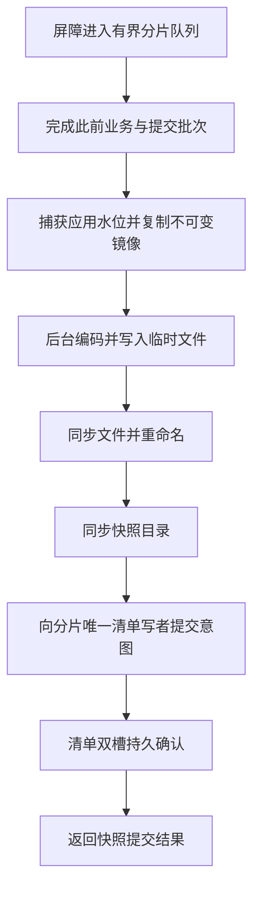
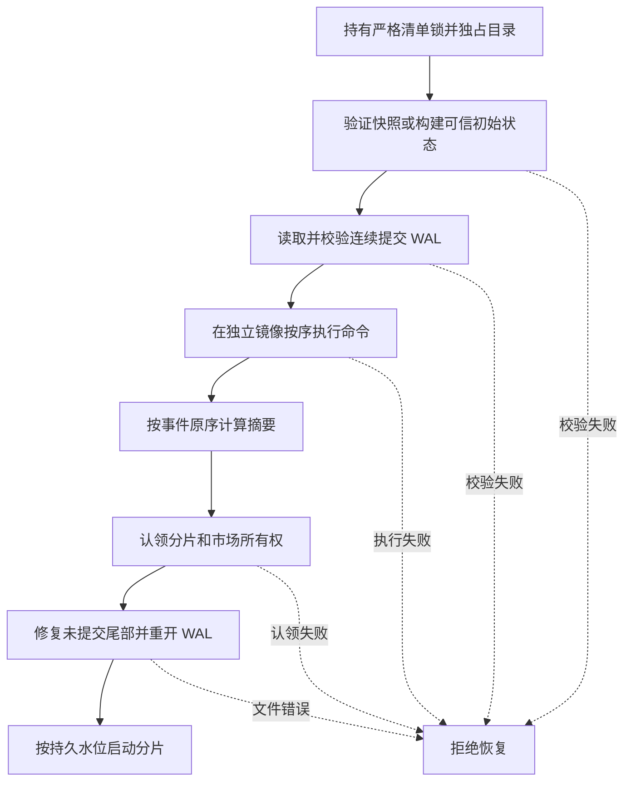

# 分片快照

`take_snapshot` 控制消息与业务消息共用有界分片队列。唯一撮合线程处理屏障时捕获最后已应用序号，复制订单簿、逻辑时间、预留登记、用户纪元、幂等窗口和客户端身份；该控制消息不分配业务序号，也不写业务 WAL。批量持久提交入口先处理屏障之前的批次，再捕获独立内存镜像。

调用方从屏障取得镜像后，将其提交给该分片的 `SnapshotWriter`。写入器拥有单独线程和最多一个等待槽位；队列满时返回背压，未入队的镜像被丢弃，调用方可以重新捕获。每个分片同时最多一个写入器，目录锁阻止另一写入器同时使用同一目录。写入器只接受由当前分片屏障产生的镜像；从磁盘解析的镜像不能直接冒充当前屏障提交。调用方负责使用独立、稳定的快照目录，并在分片关闭前关闭并等待写入器排空。

后台线程按序执行编码、临时文件写入、文件同步、重命名和目录同步，然后向分片队列提交控制意图。分片持有的 WAL 写入器通过唯一 `ManifestManager` 登记快照，且只允许不超过当前提交前缀的序号；仅清单持久确认后回复成功。编码、文件操作、队列或清单错误均返回失败；文件同步后意图提交失败可能留下未提交文件，清单不会引用该文件。相同或较旧序号不会覆盖已提交快照。

文件使用大端 `SNP1`、格式版本、快照身份、序号和载荷长度，末尾 CRC32C 覆盖头和载荷；当前单个载荷上限为 256 MiB。当前载荷 schema 为版本 2，恢复拒绝不支持的版本；载荷包含引擎版本、集群/分片/主节点纪元、逻辑时间、应用序号、路由、订单簿、优先级、到期状态、参考价格、价格带、预留状态及归属、用户控制、幂等结果/会话别名和客户端身份。订单簿的链表和 Stop 到期桶原序均保留；普通订单及到期索引可由已验证状态重建。

`SnapshotImage::read_committed_snapshot` 根据清单读取并校验文件，核对文件和载荷序号；恢复时调用方提供可信身份、路由、容量和下单配置，任何不匹配或结构不变量失败均拒绝。`start_in_memory_from_snapshot` 可使用验证后的镜像启动进程内分片，恢复序号和去重状态；它不打开 WAL、重放快照之后的命令或提供持久化续写，不能替代崩溃重启恢复。持久分片的屏障镜像必须经过严格清单读取，且只有序号等于本地持久水位时才允许启动；落后水位的回退候选不能直接启动。

严格清单恢复保留最近两份已提交快照的身份；最新文件损坏或缺失时，可选择上一份已验证候选，并保留清单中的权威持久水位。候选序号不得落后于 WAL 回收安全水位；调用方仍须回放该序号之后的已提交 WAL，不能将候选选择当作完整启动恢复。版本 2 清单没有上一份快照记录，直到提交新快照后才可提供此候选。`read_committed_snapshot` 本身只读取最新快照且失败即返回错误。`read_recovery_candidate` 才执行回退选择。

`SnapshotImage::canonical_state` 按业务价序、同价链表、止损来源及价格、到期顺序和受控索引构造当前已实现状态的规范字节，不包含请求身份或 Arena 物理槽位。快照载荷使用 SHA-256 保存该状态摘要，恢复时重新计算并校验；文件 CRC32C 仍仅负责文件损坏检测。项目配置将 SHA-256 固定为纯软件后端；调用方通过环境覆盖 Cargo 的 rustflags 时须确保保留此约束。

`recover_snapshot_records` 在调用方持有严格清单锁、独占相关目录时，选择有效快照并读取其后的已提交 WAL。所得批次调用 `replay` 时，在隔离镜像中按照分片序号执行当前已支持的正式命令，校验纪元及逻辑时间，生成原序事件并计算摘要；失败不返回部分镜像。事件摘要使用 `matching-event-hash-v1` 领域分隔前缀及版本化、长度限定的完整事件编码，按原始顺序计算 SHA-256。该编码专用于摘要，并非对外事件线协议。

`Shard::recover_group_local` 持有严格清单锁先完成隔离重放，再修复未提交尾部、恢复本地持久水位并启动分片。无快照时，空市场可从可信空基线恢复；含市场的分片须调用 `recover_group_local_with_genesis` 并提供与原启动一致的可信市场优先级策略。调用方必须独占 WAL 和快照目录；错误策略无法从现有 WAL 自动发现。恢复仅支持 LocalDurable，真实备节点与完整市场状态仍未实现。

当前正式 WAL 命令覆盖用户栅栏、限价下单和批量撤单。按已确认的交付安排，v6 §55.6 的额外回放场景全部保留，在相关功能及其持久命令路径具备后补齐，并在最终验收前实际通过：Stop 触发移除、Amend 的预留调整与 quote-budget、CancelReplace 的 BookWithout FOK/PostOnly、PreOpen 参考价更新及批量重校验，以及市场迁移前后的普通/Stop 优先级和 market_event_seq 连续性。当前百万条用户栅栏命令带和下单、撤单的定向回放证据不覆盖这些场景；这些功能或测试尚未完成时不得宣称已满足 §55.6 全部要求。
