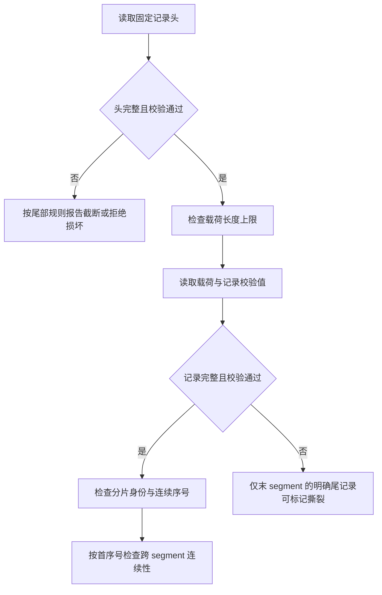

# WAL 物理记录与 segment

`matching-persistence` 提供记录编码、CRC32C、有限大小 segment 追加、顺序扫描及显式尾部截断。它尚未接入分片运行时，也不定义命令载荷编码、提交确认、fsync 策略或崩溃回放；追加或截断成功不代表磁盘持久化。

记录固定字段使用大端编码，依次为 magic、版本、集群、分片、flags、主节点 epoch、分片序号、逻辑时间、命令身份、payload 长度、头 CRC32C、payload、记录 CRC32C。当前版本仅接受 flags 为零。头 CRC 覆盖 magic 至 payload 长度，先校验再使用长度；记录 CRC 覆盖头、头 CRC 和 payload。单条 payload 最大 16 MiB，单个 segment 最大 64 MiB。CRC 用于检测意外损坏，不是防篡改认证。payload 目前是不透明字节，调用方须保证只写 durable Mutation，不能把 Query 等控制消息写入业务 WAL。

文件名使用首序号的 20 位十进制及 `.wal` 后缀；文件按首序号排序并检查跨文件连续性，segment 专用目录中的未知条目或非普通文件会被拒绝。扫描所得元数据包含完整文件 CRC32C，该值只是即时计算结果，尚无可信持久化 manifest 可以比对。新写入器只接受空目录，调用方须保证目录只有一个写入器；当前没有进程间锁，也不提供从已有文件续写。完整恢复、manifest 和写入器重启由后续工作实现。写入失败后的写入器进入失败状态。

最后 segment 的不完整记录或完整但末尾记录 CRC 错误可报告为撕裂，调用方可在**独占目录**时显式截断到最后完整记录；不自动执行截断。头 CRC 错误时不能信任长度，按损坏拒绝；非最后 segment 不允许撕裂，中间损坏、分片身份不一致及序号缺口均拒绝扫描。调用方必须在无并发写入或文件替换时执行扫描与截断；当前接口不提供进程间锁或持久化同步。

本地测试覆盖 1000 次文件截断和固定种子输入变异；它们验证当前物理组件的处理边界，不等同于持久提交后的崩溃恢复或覆盖率引导的 fuzz 验证。
