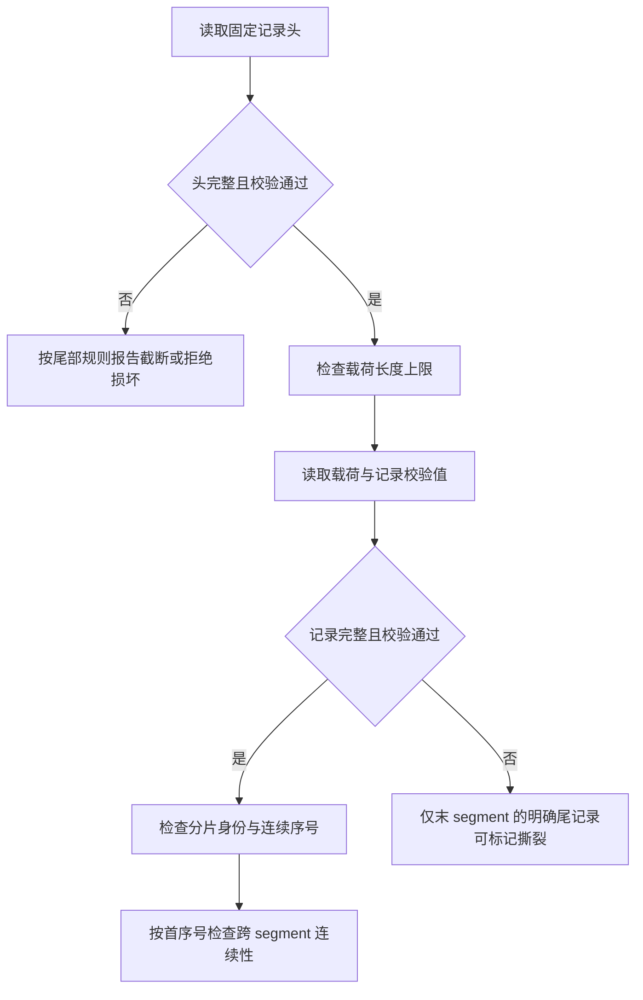
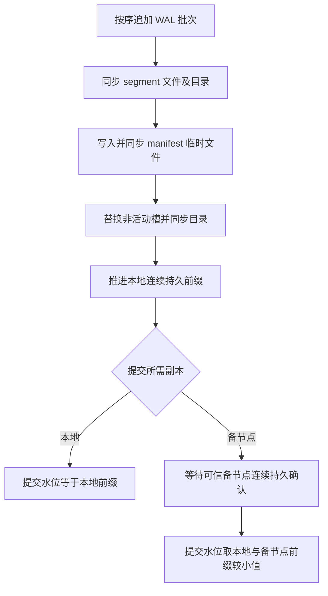

# WAL 物理记录与 segment

`matching-persistence` 提供记录编码、CRC32C、有限大小 segment 追加、顺序扫描及显式尾部截断，并提供独立的双槽 manifest 和批量同步组件。开发环境的空状态正式命令入口已接入逐条与批量本地同步，命令载荷编码用于该路径；目前不实现崩溃回放，低层追加或截断成功不代表磁盘持久化。

记录固定字段使用大端编码，依次为 magic、版本、集群、分片、flags、主节点 epoch、分片序号、逻辑时间、命令身份、payload 长度、头 CRC32C、payload、记录 CRC32C。当前版本仅接受 flags 为零。头 CRC 覆盖 magic 至 payload 长度，先校验再使用长度；记录 CRC 覆盖头、头 CRC 和 payload。单条 payload 最大 16 MiB，单个 segment 最大 64 MiB。CRC 用于检测意外损坏，不是防篡改认证。payload 目前是不透明字节，调用方须保证只写 durable Mutation，不能把 Query 等控制消息写入业务 WAL。

文件名使用首序号的 20 位十进制及 `.wal` 后缀；文件按首序号排序并检查跨文件连续性，segment 专用目录中的未知条目或非普通文件会被拒绝。扫描所得元数据包含完整文件 CRC32C，该值只是即时计算结果，尚无可信持久化 manifest 可以比对。新写入器只接受空目录，调用方须保证目录只有一个写入器；当前没有进程间锁，也不提供从已有文件续写。完整恢复与写入器重启由后续工作实现；独立的双槽 manifest 管理器见下文。写入失败后的写入器进入失败状态。

最后 segment 的不完整记录或完整但末尾记录 CRC 错误可报告为撕裂，调用方可在**独占目录**时显式截断到最后完整记录；不自动执行截断。头 CRC 错误时不能信任长度，按损坏拒绝；非最后 segment 不允许撕裂，中间损坏、分片身份不一致及序号缺口均拒绝扫描。调用方必须在无并发写入或文件替换时执行扫描与截断；当前接口不提供进程间锁或持久化同步。

本地测试覆盖 1000 次文件截断和固定种子输入变异；它们验证当前物理组件的处理边界，不等同于持久提交后的崩溃恢复或覆盖率引导的 fuzz 验证。

双槽管理器持有文件锁，以临时文件写入、文件同步、槽位重命名、目录同步的顺序持久化下一代，所有步骤成功后才发布内存状态；I/O 失败后停止管理器。启动时选择校验与版本合法的最大代际。进程间锁依赖所有写者遵守同一锁协议，不能约束绕过该协议直接修改文件的进程。

当前 manifest 使用大端 `MNF1` / 版本 1 编码及末尾 CRC32C；奇数代写入 `manifest-a`，偶数代写入 `manifest-b`。内容包括代际、复制安全序号、可选快照身份与序号、可选活动 segment、WAL 回收安全序号和有界回收计划。单槽损坏时使用仍合法的另一槽；存在槽位但两槽均无效时拒绝启动。快照和回收意图的调用方须保证其前置持久性及安全条件，记录计划本身不授权删除文件。

批量同步组件将 WAL 文件和目录同步后登记活动 segment，再推进本地连续前缀。组件在创建时固定主节点 epoch，拒绝不同 epoch 的记录与备节点确认；这个本地比较不构成租约或 fencing。备节点模式还需由可信复制适配器提供连续的实际持久确认；当前没有网络复制适配器。备节点不可用时拒绝新追加，不自动切换为本地提交。批次时限需要调用方定期驱动，批次追加返回成功不等同于已经提交；调用方必须检查提交水位才能应用和确认命令。runtime 的开发入口支持 `FsyncEach` 或 `GroupCommit`，当前仅有 `LocalDurable`；备节点模式尚未与 runtime 接通。

图中 manifest 更新仅在活动 segment 变化时发生，同一 segment 后续批次无需重新登记。`MemoryOnly` 不由持久批处理器提供持久确认；生产环境、需要崩溃恢复或启用高可用时禁止使用该模式。

## 正式命令载荷

`matching-domain` 提供版本 1 的正式命令编码和解码，已用于开发环境正式命令 WAL 路径，尚未接入恢复流程。首字节为版本，后续整数均为大端。依次保存命令身份、会话、客户端序号、可选市场、用户、路由版本及两个审计时间，再保存命令类型和完整载荷。可选值以 `0`/`1` 标志表示；字符串使用 `u32` 字节长度及 UTF-8。命令类型 `0` 为用户栅栏、`1` 为分片批量撤单、`2` 为正式限价下单；撤单范围和自成交策略均采用代码中显式定义的标记。下单载荷包含订单全部字段、客户端身份、用户控制版本及完整预留令牌（包括签名）。

版本 1 的各标记如下：

| 字段 | 字节值 |
| --- | --- |
| 订单方向 | `0` 买入，`1` 卖出 |
| 自成交策略 | `0` None，`1` CancelTaker，`2` CancelMaker，`3` CancelBoth，`4` DecrementAndCancel |
| 栅栏动作 | `0` FenceOnly，`1` FenceAndCancelAll |
| 批量撤单范围 | `0` User，`1` Market，`2` UserMarket，`3` Session，`4` All |
| 布尔值及可选值标记 | `0` 否或无，`1` 是或有 |

解码拒绝未知版本或标记、非法 UTF-8、无效价格数量、截断、多余尾部和超过 16 MiB 的输入；编码与解码不替代业务校验或签名验证。当前格式需要随协议演进保持兼容并使用黄金字节测试，不能将它视为已完成重放验证。 WAL 头与载荷均包含命令身份，未来接入和恢复必须校验二者一致。

## 分片运行时接入边界

`start_durable_fence_only` 支持 `FenceOnly`；`start_with_durable_place_support` 另支持正式普通限价 GTC/PostOnly 与市场范围 `MassCancelShard`。另外，`start_group_fence_only` 和 `start_group_place_support` 分别提供相同支持范围的 `GroupCommit` 入口。四者均固定开发环境和 `LocalDurable`，初始逻辑时间为零、预留登记表为空；支持下单的入口自行创建空订单簿。启动时需要两个不同的已有目录：WAL 目录必须为空，manifest 目录必须对应空的初始状态。启动前会按实际文件身份拒绝同一目录及路径别名；WAL 目录不应放置 manifest 文件，扫描器只接受 segment 文件。目录路径须由可信启动环境保护，身份检查与打开之间不防范恶意替换链接。新入口不接受现有 WAL 续写，不持久化启动策略、市场路由或可信风险配置。

市场路由、用户控制等前置检查以及命令去重在分配序号前执行；重复命中返回原摘要，不再写入 WAL 或重发事件。首次命令分配序号后依次追加 WAL、同步文件和目录、需要时登记 manifest，只有本地连续提交水位覆盖该序号后才安装状态并返回事件。写入、同步或登记失败使分片停止并关闭入口，不应将失败解释为业务拒绝；登记表模式拒绝绕过此路径的低层 Mutation。旧的进程内启动入口仍不写 WAL。

`GroupCommit` 的 `max_batch` 须介于 1 和分片默认入口容量 1024 之间，`max_delay_micros` 须严格为正且截止时刻可表示。工作线程按输入顺序在隔离的批次候选状态中规划命令，达到批次容量、截止时刻，或遇到查询/屏障等非正式消息时结束批次；提交本地连续水位覆盖候选序号后才安装候选并按序回复。重复命令和前置拒绝也占本批回复槽位，但不追加 WAL。等待使用单调时钟，入队会唤醒工作线程；该时钟不驱动业务时间。时限控制批量收集开始同步的时机，不中断已经开始的候选计算或磁盘同步。队列和批次按消息数限容，当前入口未按载荷字节总数限容。

standby 复制及确认、EventJournal、快照、崩溃回放、持久去重和重启续写均未实现。批次内由于时限或 segment 轮转可能提前同步连续前缀；后续写入或同步失败后分片停止，尚未安装的候选状态不对外可见，但此前前缀可能已落盘。落盘后进程在安装或回复前崩溃也可能留下已持久记录；当前无法自动重建状态或确认结果，不能把这条开发路径视为生产可恢复系统。

