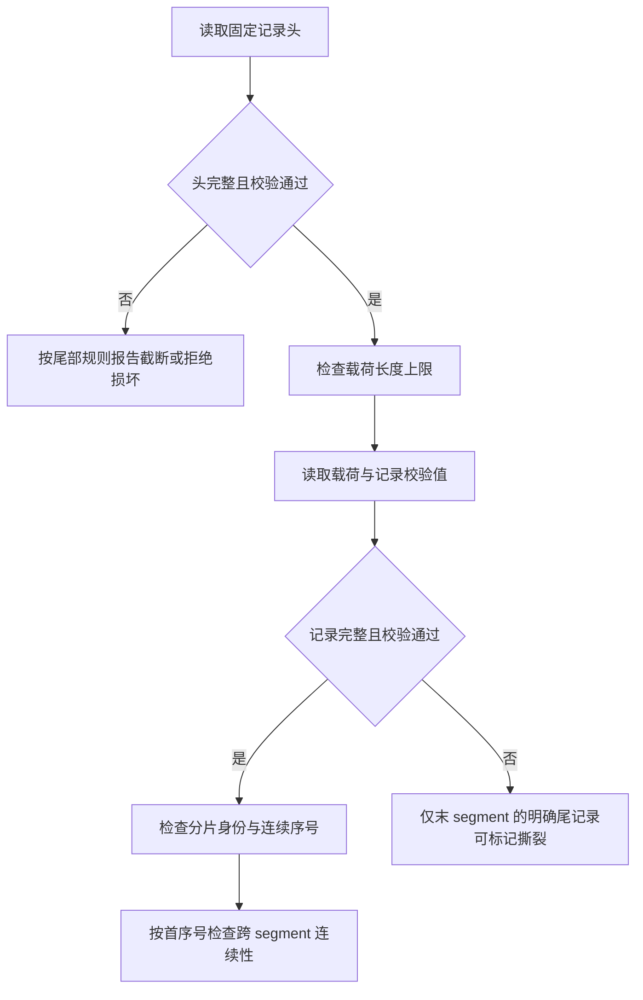
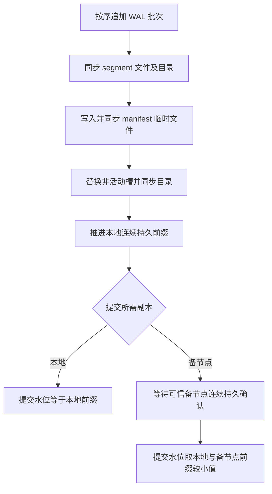
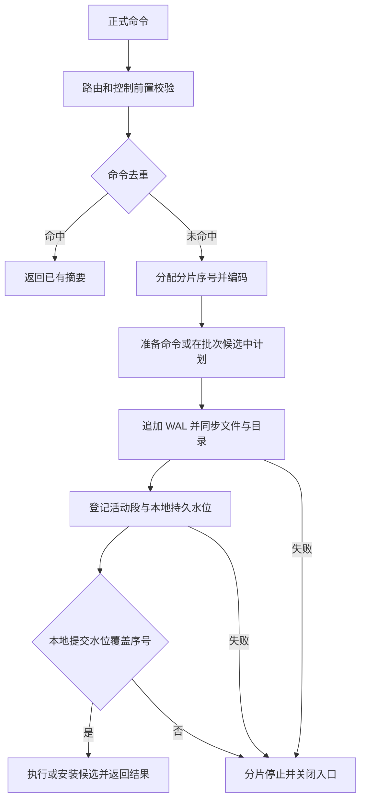
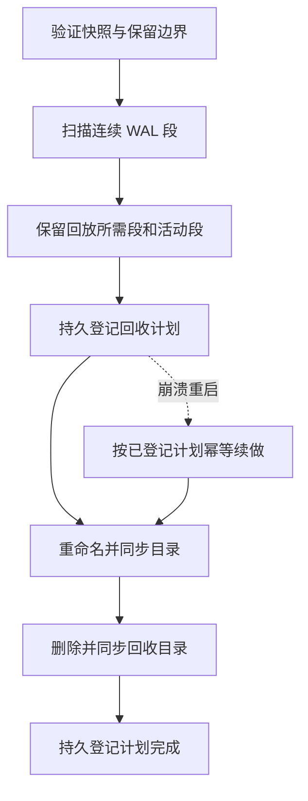

# WAL 物理记录与 segment

`matching-persistence` 提供记录编码、CRC32C、有限大小 segment 追加、顺序扫描及显式尾部截断，并提供独立的双槽 manifest 和批量同步组件。开发环境的空状态正式命令入口已接入逐条与批量本地同步，命令载荷编码用于该路径；已提供本地提交前缀扫描和正式命令解码；运行时支持严格清单锁下隔离重放并恢复 LocalDurable 批量续写；低层追加或截断成功不代表磁盘持久化。

记录固定字段使用大端编码，依次为 magic、版本、集群、分片、flags、主节点 epoch、分片序号、逻辑时间、命令身份、payload 长度、头 CRC32C、payload、记录 CRC32C。当前版本仅接受 flags 为零。头 CRC 覆盖 magic 至 payload 长度，先校验再使用长度；记录 CRC 覆盖头、头 CRC 和 payload。单条 payload 最大 16 MiB，单个 segment 最大 64 MiB。CRC 用于检测意外损坏，不是防篡改认证。payload 目前是不透明字节，调用方须保证只写 durable Mutation，不能把 Query 等控制消息写入业务 WAL。

文件名使用首序号的 20 位十进制及 `.wal` 后缀；文件按首序号排序并检查跨文件连续性，segment 专用目录中的未知条目或非普通文件会被拒绝。扫描所得元数据包含完整文件 CRC32C，该值只是即时计算结果，尚无可信持久化 manifest 可以比对。新建写入器只接受空目录；恢复入口在严格清单锁下验证和修复后重开已有活动段。调用方须保证 WAL 目录只有一个写入器；该目录本身没有进程间锁。独立的双槽 manifest 管理器见下文。写入失败后的写入器进入失败状态。

最后 segment 的不完整记录或完整但末尾记录 CRC 错误可报告为撕裂，调用方可在**独占目录**时显式截断到最后完整记录；不自动执行截断。头 CRC 错误时不能信任长度，按损坏拒绝；非最后 segment 不允许撕裂，中间损坏、分片身份不一致及序号缺口均拒绝扫描。调用方必须在无并发写入或文件替换时执行扫描与截断；当前接口不提供进程间锁或持久化同步。

本地测试覆盖 1000 次文件截断和固定种子输入变异；它们验证当前物理组件的处理边界，不等同于持久提交后的崩溃恢复或覆盖率引导的 fuzz 验证。

双槽管理器持有文件锁，以临时文件写入、文件同步、槽位重命名、目录同步的顺序持久化下一代，所有步骤成功后才发布内存状态；I/O 失败后停止管理器。启动时选择校验与版本合法的最大代际。进程间锁依赖所有写者遵守同一锁协议，不能约束绕过该协议直接修改文件的进程。

当前 manifest 使用大端 `MNF1` / 版本 3 编码及末尾 CRC32C；版本 2 在回收计划后追加本地持久水位、计划执行后首个保留段的首序号及计划所属集群和分片身份，版本 3 再追加上一份已提交快照的存在标记、身份和序号。严格恢复兼容版本 2；版本 2 只有最新快照，后续提交新快照后才建立上一份记录。旧版本 1 可供诊断读取，但不含可信水位，不允许直接写入升级或用于严格恢复；奇数代写入 `manifest-a`，偶数代写入 `manifest-b`。内容包括代际、复制安全序号、可选快照身份与序号、可选活动 segment、WAL 回收安全序号和有界回收计划。普通诊断读取可回退单槽，但槽位缺失或损坏后禁止继续写入；严格恢复要求双槽存在、校验通过且代际连续，拒绝回退或旧版槽。写入器接收首条记录前先持久写入两槽零水位，初始化失败时拒绝启动；因此首批同步前崩溃可识别并修复为空前缀。存在槽位但两槽均无效时拒绝启动。快照和回收意图的调用方须保证其前置持久性及安全条件，记录计划本身不授权删除文件。

批量同步组件先同步 WAL 文件和目录，再将活动 segment 和本地连续持久水位作为同一 manifest 意图持久化，最后推进内存中的本地连续前缀。组件在创建时固定主节点 epoch，拒绝不同 epoch 的记录与备节点确认；这个本地比较不构成租约或 fencing。备节点模式还需由可信复制适配器提供连续的实际持久确认；当前没有网络复制适配器。备节点不可用时拒绝新追加，不自动切换为本地提交。批次时限需要调用方定期驱动，批次追加返回成功不等同于已经提交；调用方必须检查提交水位才能应用和确认命令。runtime 的开发入口支持 `FsyncEach` 或 `GroupCommit`，当前仅有 `LocalDurable`；备节点模式尚未与 runtime 接通。

每个已同步批次都更新 manifest 水位；接收首条记录前先持久初始化两个槽。`MemoryOnly` 不由持久批处理器提供持久确认；生产环境、需要崩溃恢复或启用高可用时禁止使用该模式。

## 正式命令载荷

`matching-domain` 提供版本 1 的正式命令编码和解码，已用于开发环境正式命令 WAL 路径和运行时状态重放。首字节为版本，后续整数均为大端。依次保存命令身份、会话、客户端序号、可选市场、用户、路由版本及两个审计时间，再保存命令类型和完整载荷。可选值以 `0`/`1` 标志表示；字符串使用 `u32` 字节长度及 UTF-8。命令类型 `0` 为用户栅栏、`1` 为分片批量撤单、`2` 为正式限价下单，`3`–`10` 依次为开始时段、创建市场、更新市场、开市、暂停、恢复、结束时段及关市；撤单范围和自成交策略均采用代码中显式定义的标记。下单载荷包含订单全部字段、客户端身份、用户控制版本及完整预留令牌（包括签名）。逐条同步与有限组提交路径支持创建、开始时段、开市、暂停、恢复、结束时段、关市及部分配置更新并可重放；Stop 活单部分配置更新已覆盖候选及编码命令重放，正式 Stop 下单 WAL 尚未接入；资产 scale、费率等配置更新仍未完成。

版本 1 的各标记如下：

| 字段 | 字节值 |
| --- | --- |
| 订单方向 | `0` 买入，`1` 卖出 |
| 自成交策略 | `0` None，`1` CancelTaker，`2` CancelMaker，`3` CancelBoth，`4` DecrementAndCancel |
| 栅栏动作 | `0` FenceOnly，`1` FenceAndCancelAll |
| 批量撤单范围 | `0` User，`1` Market，`2` UserMarket，`3` Session，`4` All |
| 布尔值及可选值标记 | `0` 否或无，`1` 是或有 |

解码拒绝未知版本或标记、非法 UTF-8、无效价格数量、截断、多余尾部和超过 16 MiB 的输入；编码与解码不替代业务校验或签名验证。当前格式需要随协议演进保持兼容并使用黄金字节测试，不能将它视为已完成重放验证。 WAL 头与载荷均包含命令身份；独立恢复解码入口会校验二者一致。

## 分片运行时接入边界

`start_durable_fence_only` 支持 `FenceOnly`；`start_with_durable_place_support` 另支持正式普通限价 GTC/PostOnly 与市场范围 `MassCancelShard`。另外，`start_group_fence_only` 和 `start_group_place_support` 分别提供相同支持范围的 `GroupCommit` 入口。四者均固定开发环境和 `LocalDurable`，初始逻辑时间为零、预留登记表为空；支持下单的入口自行创建空订单簿。启动时需要两个不同的已有目录：WAL 目录必须为空，manifest 目录必须对应空的初始状态。启动前会按实际文件身份拒绝同一目录及路径别名；WAL 目录不应放置 manifest 文件，扫描器只接受 segment 文件。目录路径须由可信启动环境保护，身份检查与打开之间不防范恶意替换链接。新入口不接受现有 WAL 续写，不持久化启动策略、市场路由或可信风险配置。

市场路由、用户控制等前置检查以及命令去重在分配序号前执行；重复命中返回原摘要，不再写入 WAL 或重发事件。首次命令分配序号后依次追加 WAL、同步文件和目录、登记 manifest 水位，只有本地连续提交水位覆盖该序号后才安装状态并返回事件。写入、同步或登记失败使分片停止并关闭入口，不应将失败解释为业务拒绝；登记表模式拒绝绕过此路径的低层 Mutation。旧的进程内启动入口仍不写 WAL。

`GroupCommit` 的 `max_batch` 须介于 1 和分片默认入口容量 1024 之间，`max_delay_micros` 须严格为正且截止时刻可表示。工作线程按输入顺序在隔离的批次候选状态中规划命令，达到批次容量、截止时刻，或遇到查询/屏障等非正式消息时结束批次；提交本地连续水位覆盖候选序号后才安装候选并按序回复。重复命令和前置拒绝也占本批回复槽位，但不追加 WAL。等待使用单调时钟，入队会唤醒工作线程；该时钟不驱动业务时间。时限控制批量收集开始同步的时机，不中断已经开始的候选计算或磁盘同步。队列和批次按消息数限容，当前入口未按载荷字节总数限容。

standby 复制及确认、EventJournal 尚未实现；LocalDurable 的快照、已提交 WAL 重放和持久续写见 [快照说明](snapshot.md)。批次内由于时限或 segment 轮转可能提前同步连续前缀；后续写入或同步失败后分片停止，尚未安装的候选状态不对外可见，但此前前缀可能已落盘。落盘后进程在安装或回复前崩溃也可能留下已持久记录；恢复入口重放该已提交前缀并恢复有限去重窗口，调用方仍须负责目录独占和可信配置；当前并非生产级 HA 恢复系统。

恢复选择接口 `recover_committed` 仅在调用方提供可信快照序号、持久提交水位与分片身份时，从扫描结果选择区间内记录；它拒绝缺失的提交记录和身份不匹配。`recover_local` 和 `repair_local_wal` 要求调用方先验证快照内容，并允许使用清单记录的最新或上一份快照；快照序号不得落后于 WAL 已回收水位。以上低层接口不执行重放；运行时的 LocalDurable 恢复入口在调用方独占目录且提供可信配置时编排重放、尾部修复和续写。

## 本地恢复与回收

`recover_local` 以严格双槽验证后的本地持久水位筛选记录，检查分片身份和序号，已确认记录缺失时拒绝；未确认尾部不加入结果。存在 WAL 但缺少 manifest 时拒绝恢复。`recover_local_commands` 进一步解码正式命令并核对记录头与载荷中的命令身份；这两个接口不执行状态重放、截断尾部或开放续写。`repair_local_wal` 在独占目录下先验证整个提交前缀，再逆序移除额外尾段、同步目录并截断及同步活动段；已确认记录不完整时不做截断。它不启动分片或开放续写。它们仅适用于 LocalDurable，快照内容和 WAL 目录独占须由调用方验证。旧版没有可信本地水位，不能直接用于该恢复流程。

`run_wal_gc` 要求调用方提供至少两个已验证持久快照的边界和对应集群、分片身份，以及可信复制与恢复保留水位和最短保留时长，并使用严格打开的 manifest 管理器独占执行。它保守保留最旧快照之后的 WAL、该快照之前的一段以及活动段；只筛选连续的最老段。计划持久化后，依次重命名到独立回收目录、同步两个目录、删除并同步回收目录，最后持久化完成意图和已删除的连续序号水位。执行和恢复计划时校验 WAL、回收目录内已重命名段与已验证快照的分片身份；恢复时还核对持久计划中的身份、安全边界、连续前缀及首个保留段，才允许删除；manifest 本身并不永久绑定分片身份，调用方必须可信地验证 manifest、两个快照和策略身份属于同一分片，并维护目录独占及所有回收意图；快照文件与当前分片镜像的提交和校验已连接；GC 调用方仍须验证两个快照及其可信身份，当前尚无生产崩溃重放证明。

分片内存镜像及独立快照文件接口的当前进度和限制见 [快照说明](snapshot.md)。

市场配置命令的数值错误保留在 WAL 载荷中，由业务执行和重放产生稳定配置拒绝码；快照仍只接受已验证配置。
